# Kelompok K-07 Laporan Resmi Praktikum Jarkom Modul 5

**Komunikasi Data & Jaringan Komputer 2026**  
*Operation Geofront — Subnetting VLSM, Firewall Stateful & Incident Response*

---

## Anggota Kelompok

| Nama | NRP |
| :--- | :--- |
| **Evandra Raditya Fauzan** | 5027251001 |
| **Keisya Dira Anugerah** | 5027251055 |

---

## Daftar Isi

1. [Spesifikasi Masalah & Arsitektur Geofront](#spesifikasi-masalah--arsitektur-geofront)
2. [Babak 1: Perancangan Alamat IP & Infrastruktur Dasar (Soal 1 - 8)](#babak-1-membangun-geofront)
   - [1. Topologi Jaringan Geofront & Perhitungan VLSM](#1-topologi-jaringan-geofront)
   - [2. Konfigurasi Interface & IP Forwarding pada Router](#2-konfigurasi-interface--ip-forwarding-pada-router)
   - [3. Static Routing & Summary Route](#3-static-routing--nat-pada-gendou)
   - [4. NAT Masquerade & DNS Resolution](#4-nat-masquerade--dns-resolution)
   - [5. Pintu Depan Dikunci Rapat (Stateful Firewall Gendou)](#5-pintu-depan-dikunci-rapat-stateful-firewall-gendou)
   - [6. Alamat Para Pilot (IP Statis Permanen)](#6-alamat-para-pilot-konfigurasi-ip-statis-permanen-non-router)
   - [7. Membangunkan MAGI (Instalasi Paket & Listener)](#7-membangunkan-magi-instalasi-paket--listener)
   - [8. Listener Pen-Pen & Tokyo3-Core](#8-listener-pen-pen--tokyo3-core)
3. [Babak 2: Sabotase dan Hantu MAGI (Soal 9 - 12)](#babak-2-sabotase-dan-hantu-magi)
   - [9. Sabotase Routing & PBR di Shigeru](#9-sabotase-routing--pbr-di-shigeru)
   - [10. Sabotase NAT & SNAT di Misato dan Gendou](#10-sabotase-nat--snat-di-misato-dan-gendou)
   - [11. Casper Harus Jadi Hantu (ICMP Stealth)](#11-casper-harus-jadi-hantu-icmp-stealth)
   - [12. Teknisi yang Kelewat Semangat (Perbaikan Hardening Casper)](#12-teknisi-yang-kelewat-semangat-perbaikan-hardening-casper)
4. [Babak 3: Mengamankan MAGI dan Zona Sensitif (Soal 13 - 19)](#babak-3-mengamankan-magi-dan-zona-sensitif)
   - [13. Brankas Balthasar (Whitelist Pilot & Casper)](#13-brankas-balthasar-whitelist-pilot--casper)
   - [14. Jam Kunjungan Sang Pinguin (Time-Based Firewall Pen-Pen)](#14-jam-kunjungan-sang-pinguin-time-based-firewall-pen-pen)
   - [15. Banjir Ping di Pusat Komando (Rate Limit ICMP Tokyo3-Core)](#15-banjir-ping-di-pusat-komando-rate-limit-icmp-tokyo3-core)
   - [16. Pencuri yang Mencoba Setiap Pintu (Log & Reject Scan Dummy-Plug)](#16-pencuri-yang-mencoba-setiap-pintu-log--reject-scan-dummy-plug)
   - [17. Sihir Hitam di Jalur Paket (DNAT Transparent Casper ke Pen-Pen)](#17-sihir-hitam-di-jalur-paket-dnat-transparent-casper-ke-pen-pen)
   - [18. Gerbang Monolith dan Radar (Stateful Border Firewall Shigeru)](#18-gerbang-monolith-dan-radar-stateful-border-firewall-shigeru)
   - [19. Hukuman untuk Sang Pengkhianat (Isolasi Total Armisael Tanpa Sentuh Host)](#19-hukuman-untuk-sang-pengkhianat-isolasi-total-armisael-tanpa-sentuh-host)
5. [Babak Final: Siap Dihancurkan, Siap Dibangun Lagi (Soal 20)](#babak-final-siap-dihancurkan-siap-dibangun-lagi)
   - [20. Uji Kebakaran Geofront (Automated Backup & Dual Restore Verification)](#20-uji-kebakaran-geofront-automated-backup--dual-restore-verification)
6. [Master Script Otomasi No 11 - 20 (`geofront_11_20.sh`)](#master-script-otomasi-no-11---20-geofront_11_20sh)

---

## Spesifikasi Masalah & Arsitektur Geofront

Markas bawah tanah Geofront dibangun dengan topologi hierarkis yang berpusat pada router utama **Gendou** sebagai satu-satunya gerbang keluar menuju internet (`NAT1`). Seluruh infrastruktur jaringan terdiri dari **17 router**, **17 switch**, dan **25 node end-device** yang terbagi ke dalam **33 segmen jaringan** (17 segmen LAN dan 16 segmen point-to-point antar-router)

Ketentuan utama perancangan jaringan Kelompok K-07:
- **Blok Prefix Utama**: `10.67.0.0/21` (kapasitas total $2^{11} = 2.048$ alamat IP)
- **Metode Pengalamatan**: Menggunakan VLSM dengan prinsip efisiensi maksimum (prefix terkecil yang muat), diurutkan secara descending berdasarkan jumlah kebutuhan host terbesar.

---

## Babak 1: Membangun Geofront

### 1. Topologi Jaringan Geofront
**Soal:** Gendo anti pemborosan, jadi tiap subnet memakai **prefix terkecil yang muat**. Bagi prefix IP kelompokmu dengan **VLSM** untuk **17 LAN dan 16 link antar-router**, urut dari kebutuhan terbesar. Tunjukkan tabel berisi network, prefix, gateway, broadcast, IP terpakai, dan sisa. Tunjukkan juga **gambar pohon IP**, dengan subnet jalur **Dummy-Plug ke Armisael dilingkari**. Di laporan, jelaskan hitungan satu subnet. 

Topologi GNS3 Operation Geofront menghubungkan router inti Gendou ke 7 cabang router utama (`Yui`, `Hikari`, `Asuka`, `Kaji`, `Misato`, `Shigeru`, dan `Fuyutsuki`), serta 1 cabang LAN langsung (`Switch-Cmd` $\to$ `Tokyo3-Core`)

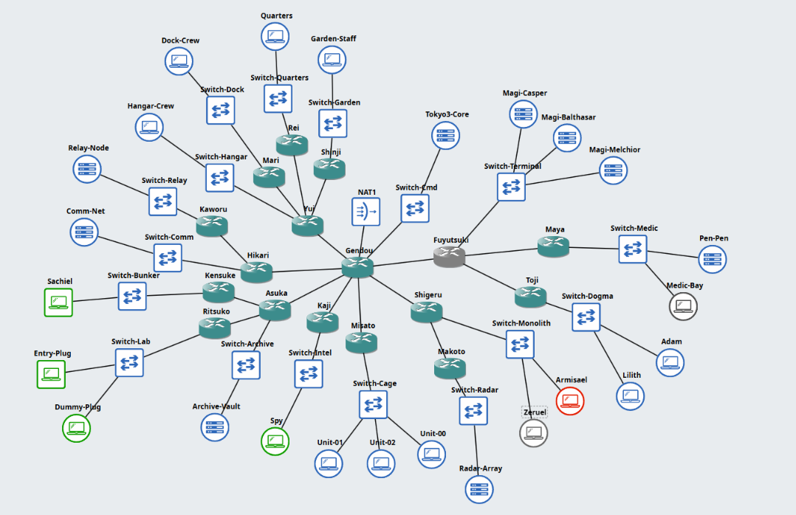

#### 1.1 Metodologi & Perhitungan Satu Subnet VLSM

Untuk menghindari pemborosan ruang alamat IP, setiap segmen dialokasikan menggunakan blok pangkat dua terkecil yang memenuhi kebutuhan seluruh host ditambah 1 alamat gateway router serta 2 alamat khusus (*Network ID* dan *Broadcast*):

```bash
Kebutuhan IP Total = Jumlah Host + 1 (Gateway) + 2 (Network & Broadcast)

Prefix = 32 - n, dengan syarat 2^n - 2 >= Jumlah Host + 1)
```

**Contoh Perhitungan Detail: Subnet #9 (`Switch-Lab` / Router `Ritsuko`):**
1. **Identifikasi Kebutuhan Host**: Segmen `Switch-Lab` melayani 2 node dengan total kebutuhan **5 IP host** (3 IP untuk `Entry-Plug` dan 2 IP untuk `Dummy-Plug`) ditambah **1 IP gateway** pada interface `eth1` router `Ritsuko`, sehingga total IP usable minimum adalah 5 + 1 = 6
2. **Penentuan Prefix Terkecil**:
   - Jika menggunakan `/30` ($n = 2$), kapasitas usable hanya $2^2 - 2 = 2\text{ IP}$ (tidak mencukupi).
   - Jika menggunakan `/29` ($n = 3$), kapasitas usable adalah $2^3 - 2 = 6\text{ IP}$ (tepat mencukupi kebutuhan 6 IP tanpa sisa terbuang).
   - Oleh karena itu, dipilih **prefix `/29`** (`255.255.255.248`) dengan ukuran blok alamat $2^3 = 8\text{ IP}$
3. **Penentuan Rentang Alamat**:
   - Karena subnet sebelumnya (`Switch-Dock`, `10.67.4.32/28`) berakhir pada alamat broadcast `10.67.4.47`, maka alamat *Network ID* berikutnya dimulai pada **`10.67.4.48/29`**[cite: 2, 4].
   - **Gateway (`Ritsuko eth1`)**: `10.67.4.49`
   - **Host `Entry-Plug`**: `10.67.4.50` s.d. `10.67.4.52`
   - **Host `Dummy-Plug`**: `10.67.4.53` s.d. `10.67.4.54`
   - **Broadcast**: $48 + 8 - 1 = 55 \r\rightarrow$ **`10.67.4.55`**
   - **Sisa IP Usable**: 6 - 6 = 0

---

#### 1.2 Tabel Alokasi Alamat IP VLSM (17 LAN & 16 Link)

Seluruh 33 segmen diurutkan dari kebutuhan host terbesar hingga link point-to-point (`/30`) dimulai dari `10.67.0.0/21`

| No | Tipe | Segmen / Link | Router Atas | Network | Prefix | Gateway / IP Atas | Broadcast | Alokasi IP Bawah / Host | Terpakai | Sisa |
| :---: | :---: | :--- | :--- | :---: | :---: | :---: | :---: | :--- | :---: | :---: |
| **1** | LAN | Switch-Quarters | Rei | `10.67.0.0` | `/23` | `10.67.0.1` | `10.67.1.255` | Quarters: `.0.2` – `.1.245` | 501 | 9 |
| **2** | LAN | Switch-Comm | Hikari | `10.67.2.0` | `/24` | `10.67.2.1` | `10.67.2.255` | Comm-Net: `.2.2` – `.2.201` | 201 | 53 |
| **3** | LAN | Switch-Hangar | Yui | `10.67.3.0` | `/25` | `10.67.3.1` | `10.67.3.127` | Hangar-Crew: `.3.2` – `.3.101` | 101 | 25 |
| **4** | LAN | Switch-Bunker | Kensuke | `10.67.3.128` | `/26` | `10.67.3.129` | `10.67.3.191` | Sachiel: `.3.130` – `.3.184` | 56 | 6 |
| **5** | LAN | Switch-Medic | Maya | `10.67.3.192` | `/27` | `10.67.3.193` | `10.67.3.223` | Medic-Bay: `.194`, Pen-Pen: `.195`–`.219` | 27 | 3 |
| **6** | LAN | Switch-Relay | Kaworu | `10.67.3.224` | `/27` | `10.67.3.225` | `10.67.3.255` | Relay-Node: `.3.226` – `.3.250` | 26 | 4 |
| **7** | LAN | Switch-Garden | Shinji | `10.67.4.0` | `/27` | `10.67.4.1` | `10.67.4.31` | Garden-Staff: `.4.2` – `.4.15` | 15 | 15 |
| **8** | LAN | Switch-Dock | Mari | `10.67.4.32` | `/28` | `10.67.4.33` | `10.67.4.47` | Dock-Crew: `.4.34` – `.4.45` | 13 | 1 |
| **9** | LAN | **Switch-Lab** | Ritsuko | `10.67.4.48` | `/29` | `10.67.4.49` | `10.67.4.55` | Entry-Plug: `.50`–`.52`, Dummy-Plug: `.53`–`.54` | 6 | 0 |
| **10** | LAN | Switch-Terminal | Fuyutsuki | `10.67.4.56` | `/29` | `10.67.4.57` | `10.67.4.63` | Casper: `.58`, Balthasar: `.59`, Melchior: `.60` | 4 | 2 |
| **11** | LAN | Switch-Cage | Misato | `10.67.4.64` | `/29` | `10.67.4.65` | `10.67.4.71` | Unit-01: `.66`, Unit-02: `.67`, Unit-00: `.68` | 4 | 2 |
| **12** | LAN | Switch-Dogma | Toji | `10.67.4.72` | `/29` | `10.67.4.73` | `10.67.4.79` | Lilith: `10.67.4.74`, Adam: `10.67.4.75` | 3 | 3 |
| **13** | LAN | **Switch-Monolith** | Shigeru | `10.67.4.80` | `/29` | `10.67.4.81` | `10.67.4.87` | Zeruel: `10.67.4.82`, Armisael: `10.67.4.83` | 3 | 3 |
| **14** | LAN | Switch-Radar | Makoto | `10.67.4.88` | `/29` | `10.67.4.89` | `10.67.4.95` | Radar-Array: `.4.90` – `.4.93` | 5 | 1 |
| **15** | LAN | Switch-Archive | Asuka | `10.67.4.96` | `/30` | `10.67.4.97` | `10.67.4.99` | Archive-Vault: `10.67.4.98` | 2 | 0 |
| **16** | LAN | Switch-Intel | Kaji | `10.67.4.100` | `/30` | `10.67.4.101` | `10.67.4.103` | Spy: `10.67.4.102` | 2 | 0 |
| **17** | LAN | Switch-Cmd | Gendou | `10.67.4.104` | `/30` | `10.67.4.105` | `10.67.4.107` | Tokyo3-Core: `10.67.4.106` | 2 | 0 |
| **18** | Link | Gendou – Yui | Gendou (`eth1`) | `10.67.4.108` | `/30` | `10.67.4.109` | `10.67.4.111` | Yui (`eth0`): `10.67.4.110` | 2 | 0 |
| **19** | Link | Gendou – Fuyutsuki | Gendou (`eth7`) | `10.67.4.112` | `/30` | `10.67.4.113` | `10.67.4.115` | Fuyutsuki (`eth0`): `10.67.4.114` | 2 | 0 |
| **20** | Link | **Gendou – Shigeru** | Gendou (`eth6`) | `10.67.4.116` | `/30` | `10.67.4.117` | `10.67.4.119` | Shigeru (`eth0`): `10.67.4.118` | 2 | 0 |
| **21** | Link | Gendou – Misato | Gendou (`eth5`) | `10.67.4.120` | `/30` | `10.67.4.121` | `10.67.4.123` | Misato (`eth0`): `10.67.4.122` | 2 | 0 |
| **22** | Link | Gendou – Kaji | Gendou (`eth4`) | `10.67.4.124` | `/30` | `10.67.4.125` | `10.67.4.127` | Kaji (`eth0`): `10.67.4.126` | 2 | 0 |
| **23** | Link | **Gendou – Asuka** | Gendou (`eth3`) | `10.67.4.128` | `/30` | `10.67.4.129` | `10.67.4.131` | Asuka (`eth0`): `10.67.4.130` | 2 | 0 |
| **24** | Link | Gendou – Hikari | Gendou (`eth2`) | `10.67.4.132` | `/30` | `10.67.4.133` | `10.67.4.135` | Hikari (`eth0`): `10.67.4.134` | 2 | 0 |
| **25** | Link | Yui – Shinji | Yui (`eth1`) | `10.67.4.136` | `/30` | `10.67.4.137` | `10.67.4.139` | Shinji (`eth0`): `10.67.4.138` | 2 | 0 |
| **26** | Link | Yui – Rei | Yui (`eth2`) | `10.67.4.140` | `/30` | `10.67.4.141` | `10.67.4.143` | Rei (`eth0`): `10.67.4.142` | 2 | 0 |
| **27** | Link | Yui – Mari | Yui (`eth3`) | `10.67.4.144` | `/30` | `10.67.4.145` | `10.67.4.147` | Mari (`eth0`): `10.67.4.146` | 2 | 0 |
| **28** | Link | Fuyutsuki – Maya | Fuyutsuki (`eth2`) | `10.67.4.148` | `/30` | `10.67.4.149` | `10.67.4.151` | Maya (`eth0`): `10.67.4.150` | 2 | 0 |
| **29** | Link | Fuyutsuki – Toji | Fuyutsuki (`eth1`) | `10.67.4.152` | `/30` | `10.67.4.153` | `10.67.4.155` | Toji (`eth0`): `10.67.4.154` | 2 | 0 |
| **30** | Link | Shigeru – Makoto | Shigeru (`eth1`) | `10.67.4.156` | `/30` | `10.67.4.157` | `10.67.4.159` | Makoto (`eth0`): `10.67.4.158` | 2 | 0 |
| **31** | Link | Asuka – Kensuke | Asuka (`eth1`) | `10.67.4.160` | `/30` | `10.67.4.161` | `10.67.4.163` | Kensuke (`eth0`): `10.67.4.162` | 2 | 0 |
| **32** | Link | **Asuka – Ritsuko** | Asuka (`eth2`) | `10.67.4.164` | `/30` | `10.67.4.165` | `10.67.4.167` | Ritsuko (`eth0`): `10.67.4.166` | 2 | 0 |
| **33** | Link | Hikari – Kaworu | Hikari (`eth1`) | `10.67.4.168` | `/30` | `10.67.4.169` | `10.67.4.171` | Kaworu (`eth0`): `10.67.4.170` | 2 | 0 |
| **Total** |  | **33 Subnet Aktif** | | `10.67.0.0` | `/21` |  | `10.67.7.255` | **Total Usable Dialokasikan: 1.130 IP** | **1.003** | **127** |

(Blok ruang kosong yang belum terpakai berada pada `10.67.4.172/30`, `10.67.4.176/28`, `10.67.4.192/26`, `10.67.5.0/24`, dan `10.67.6.0/23`)

---

#### 1.3 Pohon IP VLSM & Jalur Dummy-Plug ke Armisael

Rute paket dari node **Dummy-Plug** menuju **Armisael** melintasi jalur:  
`Dummy-Plug` $\to$ `Switch-Lab` $\to$ `Ritsuko` $\to$ `Asuka` $\to$ `Gendou` $\to$ `Shigeru` $\to$ `Switch-Monolith` $\to$ `Armisael`

Pada pohon pembagian biner `10.67.0.0/21` berikut, **5 subnet yang dilalui jalur tersebut dilingkari (ditandai kapsul merah)**:
1. **Subnet #9 (`10.67.4.48/29`)**: LAN Switch-Lab (`Ritsuko`, lokasi `Dummy-Plug`)
2. **Subnet #32 (`10.67.4.164/30`)**: Link P2P `Ritsuko` $\leftr\rightarrow$ `Asuka`
3. **Subnet #23 (`10.67.4.128/30`)**: Link P2P `Asuka` $\leftr\rightarrow$ `Gendou`
4. **Subnet #20 (`10.67.4.116/30`)**: Link P2P `Gendou` $\leftr\rightarrow$ `Shigeru`
5. **Subnet #13 (`10.67.4.80/29`)**: LAN Switch-Monolith (`Shigeru`, lokasi `Armisael`)

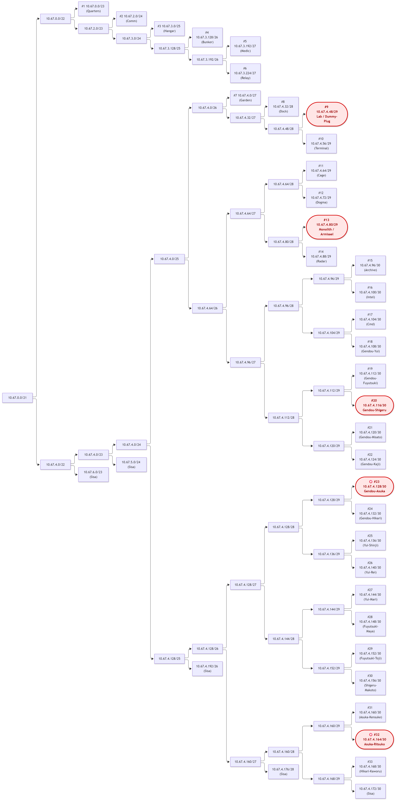

---

### 2. Konfigurasi Interface & IP Forwarding pada Router

**Soal:** kabel sudah ditarik, tapi saat Misato menekan tombol daya, Geofront tetap gelap. Tidak ada alamat dan tidak ada rute. Pasang semua node di GNS3 sesuai topologi. Beri IP ke tiap interface router sesuai soal 1, lalu aktifkan **IP forwarding** di semua router. Hanya **Gendo** yang terhubung ke NAT1 dan mendapat alamat lewat **DHCP**. Router lain baru bisa memasang paket setelah soal 4, karena internet baru ada saat itu. Tunjukkan `ip -br` di tiap router dan ping dua ujung tiap link router ke router.

#### 2.1 Konfigurasi Router

Seluruh 17 router di topologi GNS3 dikonfigurasi alamat IP statis pada setiap antarmuka sesuai tabel VLSM Soal 1 melalui `/etc/network/interfaces`, serta diaktifkan penerusan paket kernel melalui `/proc/sys/net/ipv4/ip_forward`[cite: 2, 3, 10]. Khusus pada **Gendou**, interface `eth0` dikonfigurasi menggunakan DHCP agar memperoleh IP otomatis dari `NAT1` (`192.168.122.2/24`).

- **Konfigurasi `/etc/network/interfaces` pada `Gendou`**:
  ```bash
  # WAN menuju NAT1 (DHCP)
  auto eth0
  iface eth0 inet dhcp

  # Link P2P menuju Router Cabang
  auto eth1
  iface eth1 inet static
      address 10.67.4.109
      netmask 255.255.255.252

  auto eth2
  iface eth2 inet static
      address 10.67.4.133
      netmask 255.255.255.252

  auto eth3
  iface eth3 inet static
      address 10.67.4.129
      netmask 255.255.255.252

  auto eth4
  iface eth4 inet static
      address 10.67.4.125
      netmask 255.255.255.252

  auto eth5
  iface eth5 inet static
      address 10.67.4.121
      netmask 255.255.255.252

  auto eth6
  iface eth6 inet static
      address 10.67.4.117
      netmask 255.255.255.252

  auto eth7
  iface eth7 inet static
      address 10.67.4.113
      netmask 255.255.255.252

  auto eth8
   iface eth8 inet static
    address 10.67.4.105
    netmask 255.255.255.252
    up sh /root/init.sh

Aktivasi IP Forwarding di semua router dilakukan dengan perintah:
```bash
echo 1 > /proc/sys/net/ipv4/ip_forward
```

#### 2.2 Verifikasi Konektivitas Antar-Router
Setelah konfigurasi IP dan IP forwarding, dilakukan pengujian konektivitas antar-router dengan perintah `ping` dan `ip -br a` dari satu ujung link ke ujung lainnya. Semua router berhasil saling terhubung, memastikan jalur komunikasi antar-router berfungsi dengan baik.

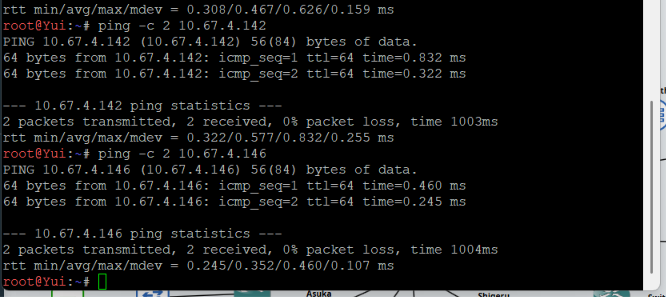


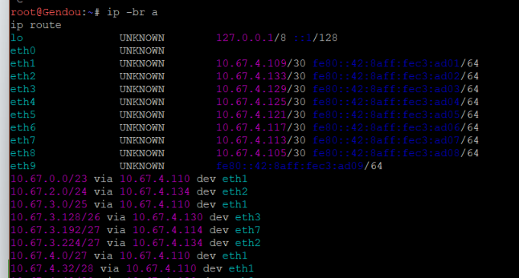


---

### 3. Static Routing & NAT pada Gendou
**Soal:** lampu mulai menyala, tapi tiap segmen masih seperti pulau terpisah. Fuyutsuki mengingatkan: bangun jalur dari Gendo ke bawah, cabang demi cabang. Hubungkan semua subnet dengan routing statis dan jumlah rute sesedikit mungkin. Router selain Gendo cukup punya satu default route ke atas dan rute untuk subnet di bawahnya. Gendo memakai default route ke NAT1. Subnet satu cabang yang bisa digabung tepat menjadi satu CIDR harus diringkas. Untuk soal 3 sampai 5, beri IP dan gateway sementara pada node uji. IP permanen dibuat di soal 6. Buktikan Armisael bisa ping ke Lilith, Sachiel, dan Comm-Net.

#### 3.1 Konfigurasi Static Routing & Summary Route (/root/init.sh)
Untuk meminimalkan jumlah entri pada tabel routing, subnet-subnet yang bersebelahan dalam satu cabang diringkas (route summarization) menjadi satu blok CIDR yang tepat, seperti pada router Gendou:
- 10.67.4.80/29 (Monolith) + 10.67.4.88/29 (Radar) $\to$ diringkas menjadi 10.67.4.80/28 via Shigeru (10.67.4.118).   
- 10.67.4.136/30 (Yui–Shinji) + 10.67.4.140/30 (Yui–Rei) $\to$ diringkas menjadi 10.67.4.136/29 via Yui (10.67.4.110). 
-  10.67.4.160/30 (Asuka–Kensuke) + 10.67.4.164/30 (Asuka–Ritsuko) $\to$ diringkas menjadi 10.67.4.160/29 via Asuka (10.67.4.130).   
- Konfigurasi Routing Statis pada Gendou (/root/init.sh):
```bash
#!/bin/sh
echo 1 > /proc/sys/net/ipv4/ip_forward
cat > /etc/resolv.conf <<EOF
nameserver 8.8.8.8
nameserver 1.1.1.1
EOF

# Cabang Yui (via 10.67.4.110) - Link Yui-Rei (.140) + Yui-Mari (.144) diringkas jadi .140/29
for n in 10.67.0.0/23 10.67.3.0/25 10.67.4.0/27 10.67.4.32/28 10.67.4.136/30 10.67.4.140/29; do ip route replace $n via 10.67.4.110; done

# Cabang Hikari (via 10.67.4.134)
for n in 10.67.2.0/24 10.67.3.224/27 10.67.4.168/30; do ip route replace $n via 10.67.4.134; done

# Cabang Asuka (via 10.67.4.130) - Link Asuka-Kensuke (.160) + Asuka-Ritsuko (.164) diringkas jadi .160/29
for n in 10.67.3.128/26 10.67.4.48/29 10.67.4.96/30 10.67.4.160/29; do ip route replace $n via 10.67.4.130; done

# Cabang Kaji (via 10.67.4.126)
ip route replace 10.67.4.100/30 via 10.67.4.126

# Cabang Misato (via 10.67.4.122)
ip route replace 10.67.4.64/29 via 10.67.4.122

# Cabang Shigeru (via 10.67.4.118) - LAN Monolith (.80/29) + Radar (.88/29) diringkas jadi .80/28
for n in 10.67.4.80/28 10.67.4.156/30; do ip route replace $n via 10.67.4.118; done

# Cabang Fuyutsuki (via 10.67.4.114) - Link Fuyutsuki-Maya (.148) + Fuyutsuki-Toji (.152) diringkas jadi .148/29
for n in 10.67.3.192/27 10.67.4.56/29 10.67.4.72/29 10.67.4.148/29; do ip route replace $n via 10.67.4.114; done
```

#### 3.2 Contoh Routing pada Router Cabang (Shigeru & Makoto):
```bash
echo 1 > /proc/sys/net/ipv4/ip_forward
ip route add default via 10.67.4.117 dev eth0
ip route add 10.67.4.88/29 via 10.67.4.158 dev eth1


# Pada Makoto (router ujung: cukup 1 default route ke atas)
echo 1 > /proc/sys/net/ipv4/ip_forward
ip route add default via 10.67.4.157 dev eth0
```

#### 3.3 Konfigurasi IP Sementara Node Uji & Pengujian Konektivitas
Diberikan IP dan gateway sementara pada node uji (Armisael, Lilith, Sachiel, dan Comm-Net) menggunakan ip addr add dan ip route add default:   
- Armisael: ip addr add 10.67.4.83/29 dev eth0 & ip route add default via 10.67.4.81
- Lilith: ip addr add 10.67.4.74/29 dev eth0 & ip route add default via 10.67.4.73
- Sachiel: ip addr add 10.67.3.130/26 dev eth0 & ip route add default via 10.67.3.129
- Comm-Net: ip addr add 10.67.2.2/24 dev eth0 & ip route add default via 10.67.2.1


Pengujian ping dari Armisael (10.67.4.83) ke Lilith (10.67.4.74), Sachiel (10.67.3.130), dan Comm-Net (10.67.2.2) berhasil seluruhnya.

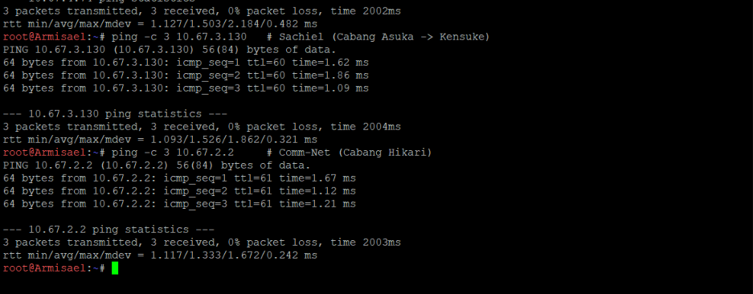

### 4. NAT Masquerade & DNS Resolution

**Soal:** Maya melaporkan bahwa semua sistem butuh update dari luar, padahal pintu keluarnya hanya Gendo. IP dari NAT1 juga bisa berganti kapan saja. Beri seluruh jaringan akses internet lewat Gendo. Konfigurasinya tidak boleh perlu diubah saat IP NAT1 berganti. Hanya traffic dari prefix internal yang keluar lewat NAT1 yang boleh diterjemahkan alamatnya, sedangkan traffic antar-LAN harus tetap membawa alamat asli pengirimnya. Node yang nanti memasang paket juga harus bisa me-resolve nama domain. Selesaikan sebelum node lain memasang paket. Buktikan `ping 8.8.8.8` dan `ping deb.debian.org` dari Armisael dan Lilith berhasil, dan tunjukkan counter rule NAT

#### 4.1 Konfigurasi NAT Masquerade di Gendou & DNS Resolver

**NAT Masquerade di Gendou:**

Digunakan target MASQUERADE pada interface keluar eth0 sehingga translasi alamat otomatis menyesuaikan IP dinamis dari NAT1 apabila IP DHCP pada eth0 berubah.

```bash
iptables -t nat -A POSTROUTING -s 10.67.0.0/21 -o eth0 -j MASQUERADE
```

**Konfigurasi DNS Resolver (/etc/resolv.conf)**
Agar seluruh router dan node dapat melakukan resolusi nama domain `(deb.debian.org)` sebelum memasang paket, ditetapkan nameserver publik pada `/etc/resolv.conf`
```bash
echo "nameserver 8.8.8.8" > /etc/resolv.conf
```

Kedua bagian ditambahkan pada skrip `/root/init.sh` agar otomatis diterapkan saat router di-boot.

#### 4.2 Verifikasi Akses Internet, DNS & Counter Rule NAT
Pengujian `ping 8.8.8.8` dan `ping deb.debian.org` dari Armisael dan Lilith berhasil mendapatkan balasan, disertai bukti bertambahnya packet/byte counter pada rule MASQUERADE melalui perintah `iptables -t nat -L POSTROUTING -v -n`

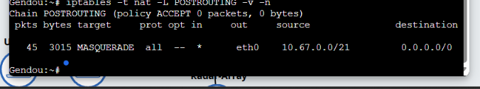

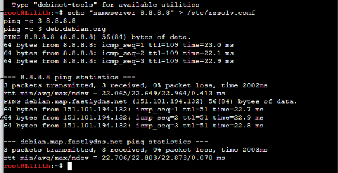

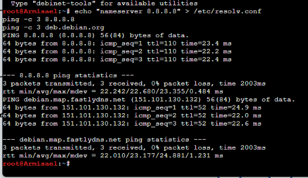

---

### 5. Pintu Depan Dikunci Rapat (Stateful Firewall Gendou)
**Soal:** Kaji memperingatkan Kaworu bahwa SEELE cukup mengetuk pintu depan. Gendo mengunci NAT1: **boleh keluar, tidak boleh dimasuki**. Di Gendo, ubah policy **INPUT dan FORWARD menjadi DROP**. Lalu izinkan empat hal: (a) balasan koneksi yang sudah ada, (b) traffic dari jaringan internal ke internet, (c) traffic antar-LAN, dan (d) traffic dari jaringan internal ke Gendo sendiri. **Loopback** dan **DHCP dari NAT1** juga harus tetap jalan. Koneksi baru dari sisi NAT1 tidak boleh masuk. Soal 2 sampai 4 harus tetap jalan, dan semuanya ditulis di `gendo.sh`. Tunjukkan `iptables -S` di Gendo, dan buktikan ping `8.8.8.8` dari Armisael masih berhasil.

#### 5.1 Konfigurasi Firewall Stateful & Skrip `gendo.sh`

Berdasarkan hasil inspeksi `iptables -S` pada `Gendou`, kebijakan default pada chain `INPUT` dan `FORWARD` diubah menjadi `DROP`, lalu ditambahkan aturan pengecualian berikut:
- **Loopback & DHCP dari `NAT1` (`eth0`)**: Mengizinkan trafik lokal `lo` serta balasan DHCP client (`UDP sport 67 dport 68`) pada `eth0`.
- **Balasan Koneksi (Stateful)**: Mengizinkan paket dengan status `RELATED,ESTABLISHED` pada chain `INPUT` maupun `FORWARD`.
- **Trafik Internal ke `Gendou` (`INPUT`)**: Mengizinkan paket dari blok internal `10.67.0.0/21` menuju interface `Gendou`.
- **Trafik Internal ke Internet & Antar-LAN (`FORWARD`)**: Mengizinkan paket dari `10.67.0.0/21` keluar ke `eth0` (`NAT1`) maupun sesama subnet `10.67.0.0/21`.

- **Isi Skrip `/root/gendo.sh` (Hasil Rekonstruksi dari `iptables -S` Aktual)**:
```bash
#!/bin/sh
iptables -F
iptables -t nat -F
iptables -X

iptables -P INPUT DROP
iptables -P FORWARD DROP
iptables -P OUTPUT ACCEPT

iptables -A INPUT -i lo -j ACCEPT
iptables -A INPUT -i eth0 -p udp --sport 67 --dport 68 -j ACCEPT

iptables -A INPUT -m conntrack --ctstate ESTABLISHED,RELATED -j ACCEPT
iptables -A FORWARD -m conntrack --ctstate ESTABLISHED,RELATED -j ACCEPT

iptables -A INPUT -s 10.67.0.0/21 -j ACCEPT
iptables -A FORWARD -s 10.67.0.0/21 -o eth0 -j ACCEPT
iptables -A FORWARD -s 10.67.0.0/21 -d 10.67.0.0/21 -j ACCEPT

iptables -t nat -A POSTROUTING -s 10.67.0.0/21 -o eth0 -j MASQUERADE
```

#### 5.2 Verifikasi iptables -S & Ping Internet dari Armisael
Dilakukan verifikasi output `iptables -S` pada Gendou untuk memastikan policy INPUT DROP dan FORWARD DROP aktif beserta ketujuh rule di atas, serta pengujian ping 8.8.8.8 dari Armisael (10.67.4.83) yang tetap berhasil.

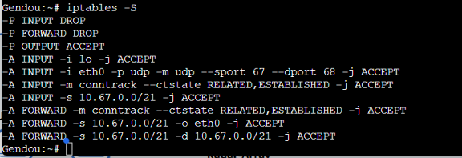


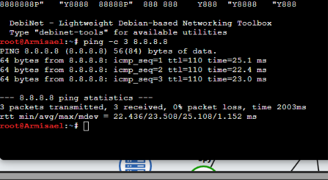

---


### 6. Alamat Para Pilot (Konfigurasi IP Statis Permanen Non-Router)
**Soal:** jaringan sudah hidup, tapi para pilot dan staf tidak tahu alamat mereka sendiri. Unit-01 bahkan tidak tahu siapa gateway-nya. Beri IP statis dan gateway ke semua node non-router, sesuai aturan alamat di glosarium. Simpan agar bertahan setelah restart. Tunjukkan ip -br dan ping ke gateway di Unit-01.   

#### 6.1 Konfigurasi IP Statis Permanen (/etc/network/interfaces)
Seluruh 25 node non-router dikonfigurasi alamat IP statis dan default gateway secara permanen di dalam file `interfaces` masing-masing node, contohnya pada `Unit-01`:

```bash
auto eth0
iface eth0 inet static
    address 10.67.4.66
    netmask 255.255.255.248
    gateway 10.67.4.65
    up sh /root/init.sh
```

lalu pada skrip `/root/init.sh` ditambahkan konfigurasi DNS resolver agar DNS dan service otomatis aktif saat boot/restart:

```bash
#!/bin/sh
printf "nameserver 8.8.8.8\n nameserver 1.1.1.1\n" > /etc/resolv.conf
```

Konfigurasi serupa diterapkan pada seluruh node non-router lainnya sesuai tabel VLSM Soal 1 dan dapat dilihat pada direktori `routings/`.

#### 6.2 Verifikasi ip -br a dan Ping ke Gateway di Unit-01
Dilakukan pengecekan ip -br a pada Unit-01 `(10.67.4.66/29)` serta pengujian ping menuju gateway-nya yaitu router Misato `(10.67.4.65)` dengan hasil berhasil tanpa packet loss.

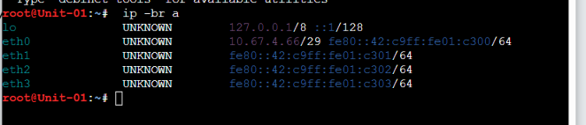

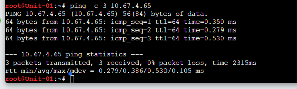


---

### 7. Membangunkan MAGI (Instalasi Paket & Listener)

**Soal:** Casper, Balthasar, dan Melchior di Switch-Terminal menunggu diaktifkan. Ritsuko ingin ketiganya melayani dulu, urusan keamanan dibahas nanti. Pasang iptables dan netcat-traditional lewat `/root/<nama>.sh`, lalu nyalakan listener sesuai port di glosarium. Dari Lilith, kirim pesan ke ketiganya dan ke port 5001 Balthasar. Tampilkan pesan yang diterima di tiap node.   

#### 7.1 Instalasi Paket & Aktivasi Listener
Pada ketiga node superkomputer di segmen Switch-Terminal (10.67.4.56/29), dibuat skrip eksekusi /root/<nama>.sh untuk memasang paket iptables serta netcat-traditional dan menjalankan listener TCP pada port sesuai glosarium:
- Magi-Casper (10.67.4.58): /root/casper.sh — mengaktifkan listener pada port 5000.
- Magi-Balthasar (10.67.4.59): /root/balthasar.sh — mengaktifkan listener pada port 5000 dan port 5001.
- Magi-Melchior (10.67.4.60): /root/melchior.sh — mengaktifkan listener pada port 5000.
Contoh Struktur Skrip /root/balthasar.sh

```bash:
#!/bin/sh
echo "nameserver 8.8.8.8" > /etc/resolv.conf
apt -o Acquire::Check-Valid-Until=false update
apt install -y --allow-unauthenticated iptables netcat-traditional
pkill -f "nc -l" 2>/dev/null
while true; do nc -l -p 5000 >> /root/balthasar_5000.log; done &
while true; do nc -l -p 5001 >> /root/balthasar_5001.log; done &
```

#### Pengujian Pengiriman Pesan dari Lilith ke Ketiga Node MAGI
Dari node `Lilith (10.67.4.74)`, dikirimkan pesan teks menggunakan nc menuju `10.67.4.58:5000 (Magi-Casper)`, `10.67.4.59:5000` & `10.67.4.59:5001 (Magi-Balthasar)`, serta `10.67.4.60:5000 (Magi-Melchior)` menggunakan: 
```bash
echo "Halo Casper dari Lilith" | nc -w 1 10.67.4.58 5000
echo "Halo Balthasar 5000 dari Lilith" | nc -w 1 10.67.4.59 5000
echo "Halo Balthasar 5001 dari Lilith" | nc -w 1 10.67.4.59 5001
echo "Halo Melchior dari Lilith" | nc -w 1 10.67.4.60 5000
```

Dan pesan tersebut tampil pada masing-masing terminal node penerima menggunakan `cat /root/*.log`:
- Magi-Casper 

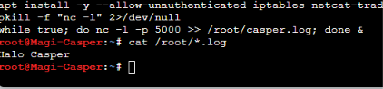


- Magi-Balthasar (port 5000 & 5001)


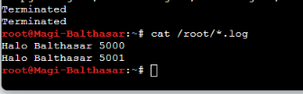


- Magi-Melchior


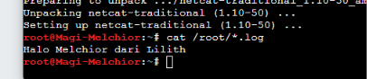

---

### 8. Listener Pen-Pen & Tokyo3-Core
**Soal:** Pen-Pen dan Tokyo3-Core sudah ditandai sebagai calon sasaran pertama SEELE. Sebelum dilindungi, keduanya harus melayani dulu agar kamu tahu kondisi normalnya. Koneksi ke port 80 dijawab `Welcome to {hostname}`. Koneksi ke `port 8080` di Tokyo3-Core dijawab `syifa imutz`. Tunjukkan nc dari Lilith ke ketiga port itu. Tunjukkan juga bahwa port yang tidak dilayani, misalnya 22, langsung gagal, bukan menggantung

#### 8.1 Konfigurasi Listener pada Pen-Pen & Tokyo3-Core

**Pen-Pen (10.67.3.195):** Port 80 merespons dengan string Welcome to Pen-Pen di `penpen.sh`:
```bash
#!/bin/sh
apt -o Acquire::Check-Valid-Until=false update
apt install -y --allow-unauthenticated iptables netcat-traditional

pkill -f "nc.traditional" 2>/dev/null
while true; do
    nc.traditional -l -p 80 -c 'echo "Welcome to $(hostname)"'
    sleep 0.2
done &
```

**Tokyo3-Core (10.67.4.106):** Port 80 merespons dengan string Welcome to Tokyo3-Core dan port 8080 merespons dengan string syifa imutz di `tokyo3.sh`:

```bash
apt -o Acquire::Check-Valid-Until=false update
apt install -y --allow-unauthenticated iptables netcat-traditional

pkill -f "nc.traditional" 2>/dev/null
while true; do
    nc.traditional -l -p 80 -c 'echo "Welcome to $(hostname)"'
    sleep 0.2
done &

while true; do
    nc.traditional -l -p 8080 -c 'echo "syifa imutz"'
    sleep 0.2
done &
```
#### Pengujian Koneksi dari Lilith & Uji Port Tertutup (22)

Dari node `Lilith (10.67.4.74) ` menggunakan nc:
   ```bash
   nc -w 2 10.67.3.195 80 </dev/null
   nc -w 2 10.67.4.106 80 </dev/null
   nc -w 2 10.67.4.106 8080 </dev/null
   nc -vz -w 2 10.67.4.106 22
   ```

**1. Koneksi ke 10.67.3.195 80 (Pen-Pen)** langsung membalas Welcome to Pen-Pen.

 **2. Koneksi ke 10.67.4.106 80 (Tokyo3-Core)** langsung membalas Welcome to Tokyo3-Core.

 **3. Koneksi ke 10.67.4.106 8080 (Tokyo3-Core)** langsung membalas syifa imutz.

 **4. Koneksi ke port yang tidak dilayani seperti nc -vz 10.67.4.106 22** langsung ditolak (Connection refused) tanpa menggantung (hang), karena kedua server merespons dengan paket TCP RST untuk port yang tertutup.

 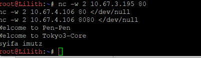


---

## Babak 2: Sabotase dan Hantu MAGI

Geofront berjalan, tapi tangan tak dikenal mulai merusaknya. Pada soal sabotase, yaitu **soal 9, 10, dan 12**, jalankan script ujian dari asisten **tanpa membaca isinya**. Temukan **semua penyebab**, karena bisa lebih dari satu. Perbaiki, lalu jelaskan kenapa gejalanya begitu.

### 9. Sabotase Routing & PBR di Shigeru
**Soal:** Tengah malam masuk laporan bahwa ada yang mengutak-atik jalur belakang di sekitar Shigeru. Lilith tidak mendapat jawaban dari Armisael, padahal Armisael masih bisa ping gateway-nya sendiri. Jalankan `break_routing.sh` di **Shigeru**. Buktikan Lilith bisa ping Armisael kembali setelah perbaikan.

#### 9.1 Eksekusi Skrip Sabotase & Diagnosa Bertahap di Shigeru

Skrip sabotase diunduh dan dijalankan langsung pada router **Shigeru** tanpa membaca isinya:
```bash
wget --no-check-certificate '[https://docs.google.com/uc?export=download&id=1ub7LjL2BdZdVq6n_AbuqcO416Z8QJGVs](https://docs.google.com/uc?export=download&id=1ub7LjL2BdZdVq6n_AbuqcO416Z8QJGVs)' -O /root/break_routing.sh
chmod +x /root/break_routing.sh
sh /root/break_routing.sh
```

Setelah skrip dijalankan, dilakukan pemeriksaan awal pada antarmuka, tabel routing utama (main), status IP forwarding, serta aturan firewall iptables di Shigeru: 

```bash
ip -br a
ip route
cat /proc/sys/net/ipv4/ip_forward
iptables -S
iptables -t nat -S
```

Dari pengecekan tahap pertama ini, IP antarmuka dan aturan iptables terpantau aman, namun ditemukan 3 penyebab awal pada konfigurasi routing dan forwarding:

- **ip_forward diubah menjadi 0:**

   Kernel Linux di Shigeru dimatikan fungsi penerusan paket antar-interface-nya. Akibatnya, Shigeru hanya bertindak sebagai host biasa—tetap membalas ping dari Armisael yang ditujukan ke IP gateway-nya sendiri `(10.67.4.81)`, tetapi menolak meneruskan paket yang melintas antara `eth0` dan `eth2`.

- **Rute `blackhole 10.67.4.72/29 ` disisipkan:**

   Subnet `10.67.4.72/29` merupakan jaringan milik `Lilith (10.67.4.74)`. Karena rute spesifik `/29` lebih diprioritaskan (longest prefix match) dibandingkan default route, paket menuju jaringan Lilith langsung dibuang diam-diam oleh Shigeru.

- **default route dibelokkan ke 10.67.4.158 dev eth1 (Makoto):**

   Jalur keluar utama (default gateway) Shigeru diarahkan ke bawah menuju router Makoto (10.67.4.158 via eth1), bukan ke atas menuju router induk Gendou (10.67.4.117 via eth0), sehingga trafik menuju jaringan lain tersesat ke Makoto.

#### 9.2 Perbaikan Tahap Pertama & Pengujian Awal (Masih Gagal)

Dilakukan perbaikan terhadap ketiga penyebab awal tersebut pada Shigeru:

```bash
# 1. Aktifkan kembali IP forwarding
echo 1 > /proc/sys/net/ipv4/ip_forward

# 2. Hapus rute blackhole ke jaringan Lilith
ip route del blackhole 10.67.4.72/29

# 3. Kembalikan default route yang benar ke arah Gendou (eth0)
ip route replace default via 10.67.4.117 dev eth0

# 4. Pastikan rute ke jaringan bawah Makoto (Radar-Array) tetap ada
ip route replace 10.67.4.88/29 via 10.67.4.158 dev eth1
```


Namun, saat diuji kembali dari `Lilith (10.67.4.74)` dengan perintah `ping -c 3 10.67.4.83`, koneksi menuju Armisael masih gagal menerima balasan.

#### 9.3 Pelacakan Hop-by-Hop & Penemuan Penyebab Ke-4 (`ip rule`)
Untuk melacak titik putusnya paket, dilakukan ping bertahap (hop-by-hop) dari Lilith (10.67.4.74) sepanjang jalur menuju Armisael:

```bash
ping -c 1 10.67.4.73    # 1. Toji (gateway Lilith) -> Berhasil
ping -c 1 10.67.4.153   # 2. Fuyutsuki              -> Berhasil
ping -c 1 10.67.4.121   # 3. Gendou                 -> Berhasil
ping -c 1 10.67.4.118   # 4. Shigeru (eth0)         -> Berhasil
ping -c 1 10.67.4.81    # 5. Shigeru (eth2 / GW)    -> Berhasil
ping -c 1 10.67.4.83    # 6. Armisael               -> Gagal
```

Karena paket tembus hingga titik ke-5 (10.67.4.81) tetapi gagal saat melewati Shigeru menuju titik ke-6 (10.67.4.83), dilakukan pemeriksaan aturan Policy-Based Routing (ip rule) dan per-interface forwarding di Shigeru:

```bash
ip rule
cat /proc/sys/net/ipv4/conf/eth0/forwarding
cat /proc/sys/net/ipv4/conf/eth2/forwarding
ip route show table 100
```

Dari hasil pemeriksaan tersebut, ditemukan penyebab baru:

- Skrip sabotase menyisipkan aturan PBR pada prioritas 90 (lebih tinggi dibandingkan tabel main pada prioritas 32766).

- Saat Armisael melakukan ping ke IP gateway-nya sendiri (10.67.4.81), paket ditangani lebih dahulu oleh prioritas 0 (lookup local) sehingga tetap berhasil.

- Namun saat Armisael membalas ping dari Lilith, paket balasan yang masuk melalui interface eth2 (iif eth2) langsung dicegat oleh aturan prioritas 90 dan dipaksa membaca tabel routing 100 (unreachable default), alih-alih tabel main yang sudah diperbaiki.

#### 9.4 Perbaikan Tahap Kedua & Verifikasi Akhir

Aturan PBR pada prioritas 90 dihapus dan tabel routing 100 dibersihkan pada Shigeru:

```bash
ip rule del pref 90
ip route flush table 100
ip rule
```

Setelah hanya tersisa prioritas standar (0: local, 32766: main, dan 32767: default), dilakukan pengujian ulang dari Lilith (10.67.4.74) ke Armisael (10.67.4.83) berupa`ping -c 3 10.67.4.83`

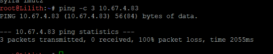

Hasil pengujian menunjukkan seluruh paket echo-reply dari Armisael kembali diterima oleh Lilith.

---

### 10. Sabotase NAT & SNAT di Misato dan Gendou
**Soal:** Paginya giliran para pilot mengeluh. Unit-01, Unit-02, dan Unit-00 di Cage tidak bisa ping 8.8.8.8. Padahal Spy di Intel baik-baik saja, dan ping dari Cage ke Lilith normal. Jalankan `break_nat.sh` di **Misato dan di Gendo**. Filenya sama, dijalankan di masing-masing node. Jelaskan kenapa Cage terdampak tapi Intel tidak. Buktikan Unit-01 bisa ping 8.8.8.8, dan sebutkan **di router mana alamat sumber diterjemahkan**.

#### 10.1 Eksekusi Skrip Sabotase & Diagnosa pada Misato dan Gendou

Skrip `break_nat.sh` diunduh dan dijalankan secara terpisah pada router **Misato** dan **Gendou** tanpa membaca isinya:
```bash
wget --no-check-certificate '[https://drive.usercontent.google.com/download?id=1oX7r9BmMPumqrIb71Vbk43Y6CQEOvDRJ&export=download&confirm=t](https://drive.usercontent.google.com/download?id=1oX7r9BmMPumqrIb71Vbk43Y6CQEOvDRJ&export=download&confirm=t)' -O /root/break_nat.sh
chmod +x /root/break_nat.sh
sh /root/break_nat.sh
```

Karena gejala menunjukkan subnet `Cage (10.67.4.64/29)` tetap dapat melakukan ping ke `Lilith (10.67.4.74)` (menandakan jalur routing internal berjalan normal) dan `Spy (10.67.4.102)` di subnet Intel tetap dapat mengakses `8.8.8.8`, dilakukan pemeriksaan tabel NAT, firewall filter, routing, dan PBR pada kedua router (Misato dan Gendou):

```bash
iptables -t nat -S
iptables -S
ip route
ip rule
```

Dari hasil pengecekan tersebut, ditemukan 2 penyebab sabotase (masing-masing satu aturan pada tabel nat di Misato dan di Gendou):

 **1. Aturan SNAT palsu di Misato** (`-A POSTROUTING -s 10.67.4.64/29 ! -d 10.67.0.0/16 -o eth0 -j SNAT --to-source 172.31.99.1`):

  - Seluruh paket yang berasal dari subnet `Cage (10.67.4.64/29)` dengan tujuan ke luar jaringan internal (`! -d 10.67.0.0/16`, seperti `8.8.8.8)` diubah alamat IP sumbernya oleh Misato menjadi IP fiktif 172.31.99.1.

   - Ketika paket tersebut diteruskan ke Gendou, aturan firewall `FORWARD` di Gendou (`-A FORWARD -s 10.67.0.0/21 -o eth0 -j ACCEPT`) langsung membuang paket tersebut karena alamat sumber 172.31.99.1 berada di luar blok internal 10.67.0.0/21.

   - **Mengapa Cage ke Lilith tetap normal?** Karena aturan SNAT di Misato memiliki pengecualian tujuan `! -d 10.67.0.0/16`, sehingga trafik internal menuju Lilith (10.67.4.74) tidak diubah alamat sumbernya dan tetap diteruskan secara normal.

**2. Aturan bypass NAT (RETURN) di Gendou** (`-A POSTROUTING -s 10.67.4.64/29 -o eth0 -j RETURN`):

- Aturan ini disisipkan tepat di atas aturan `MASQUERADE`. Akibatnya, paket dari subnet Cage (10.67.4.64/29) langsung keluar dari chain `POSTROUTING` di Gendou tanpa melalui proses translasi `MASQUERADE`, sehingga paket keluar melalui eth0 menuju `192.168.122.1` dengan membawa alamat IP privat mentah (10.67.4.x) yang tidak dapat dirutekan kembali oleh internet.

#### 10.2 Analisis Dampak pada Subnet Cage dan Subnet Intel (Spy)

Kedua aturan sabotase yang disuntikkan ke tabel nat di Misato dan Gendou mengunci parameter sumber secara spesifik hanya untuk blok subnet Cage `(-s 10.67.4.64/29)`. Paket dari node Spy pada subnet Intel `(10.67.4.100/30)` tetap berada di dalam blok `10.67.0.0/21` dan tidak cocok dengan kedua aturan sabotase tersebut, sehingga paketnya diteruskan dan di-`MASQUERADE` secara normal oleh Gendou.

Alamat sumber diterjemahkan di router Gendou pada interface keluar` WAN (eth0) `melalui mekanisme `MASQUERADE` menjadi `IP WAN 192.168.122.2`, tidak terjadi di router Misato, karena Misato berperan sebagai router internal yang hanya meneruskan paket tanpa melakukan NAT.

#### 10.3 Langkah Perbaikan & Verifikasi Konektivitas Unit-01 ke 8.8.8.8
Dilakukan penghapusan kedua aturan sabotase pada tabel nat di masing-masing router:

```bash
# 1. Di Misato: hapus aturan SNAT palsu ke 172.31.99.1
iptables -t nat -D POSTROUTING -s 10.67.4.64/29 ! -d 10.67.0.0/16 -o eth0 -j SNAT --to-source 172.31.99.1

# 2. Di Gendou: hapus aturan RETURN bypass NAT untuk subnet Cage
iptables -t nat -D POSTROUTING -s 10.67.4.64/29 -o eth0 -j RETURN

# 3. Verifikasi aturan tabel nat pada kedua router
iptables -t nat -S
```

Setelah dibersihkan, tabel nat di Misato kembali kosong tanpa aturan SNAT, sedangkan di Gendou hanya menyisakan `-A POSTROUTING -s 10.67.0.0/21 -o eth0 -j MASQUERADE`.

Pengujian dilakukan kembali dari `Unit-01 (10.67.4.66)` menuju `8.8.8.8`:

```bash
ping -c 3 8.8.8.8
```

Hasil pengujian menunjukkan seluruh paket ICMP berhasil mendapatkan balasan dari `8.8.8.8` tanpa packet loss.

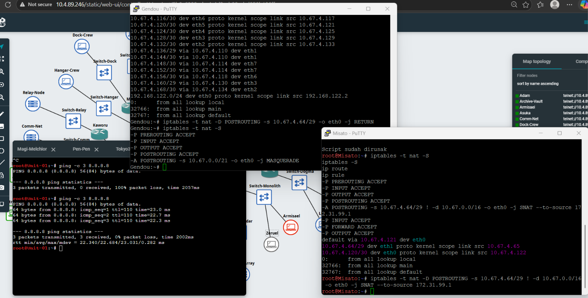

---

### 11. Casper Harus Jadi Hantu (ICMP Stealth)

**Soal:** Casper adalah MAGI paling rahasia. Kalau SEELE tahu ia masih hidup, mereka tahu ke mana harus menyerang. Tidak ada perangkat lain yang boleh mem-ping Casper, termasuk yang satu switch. Casper sendiri tetap boleh mem-ping siapa saja. Layanan TCP 5000 Casper tetap hidup. Buktikan ping ke Casper dari Balthasar dan Lilith gagal, sedangkan ping dari Casper ke keduanya berhasil.

#### 11.1 Analisis & Langkah Teknis
- **Node Sasaran:** `Magi-Casper` (`10.67.4.58`) pada Switch-Terminal (`10.67.4.56/29`).
- **Analisis Kebutuhan:**
  1. **ICMP Stealth:** Casper tidak boleh merespons pesan ICMP `echo-request` yang masuk dari mana pun, baik dari node luar (seperti Lilith `10.67.4.74`) maupun tetangga satu switch (seperti Balthasar `10.67.4.59`).
  2. **Ping Keluar Tetap Berfungsi:** Casper tetap harus bisa melakukan ping ke node lain. Saat Casper mengirim `echo-request`, paket balasan yang diterima adalah `echo-reply` dengan status conntrack `ESTABLISHED,RELATED`. Oleh karena itu, kita hanya memblokir tipe ICMP `echo-request` yang masuk, dan tetap mengizinkan state `ESTABLISHED,RELATED`.
  3. **Layanan TCP 5000:** Layanan TCP port 5000 harus tetap dibuka (`-p tcp --dport 5000 -j ACCEPT`) agar fungsi MAGI tidak terganggu.

#### 11.2 Konfigurasi iptables pada Magi-Casper
Konfigurasi disuntikkan ke dalam `/root/casper.sh` (atau via `sh geofront_11_20.sh casper`):
```bash
# 1. Izinkan Loopback
iptables -A INPUT -i lo -j ACCEPT

# 2. Izinkan koneksi balasan yang sudah terbentuk (ESTABLISHED, RELATED)
iptables -A INPUT -m conntrack --ctstate ESTABLISHED,RELATED -j ACCEPT

# 3. Izinkan koneksi masuk ke port layanan TCP 5000
iptables -A INPUT -p tcp --dport 5000 -j ACCEPT

# 4. Tolak semua permintaan ping (ICMP echo-request) dari mana pun
iptables -A INPUT -p icmp --icmp-type echo-request -j DROP
```

#### 11.3 Pengujian & Pembuktian
1. **Pengujian Ping Masuk ke Casper (Harus Gagal / 100% Packet Loss):**
   - Dari **Balthasar** (`10.67.4.59`):
     ```bash
     ping -c 3 10.67.4.58
     # Hasil: 3 packets transmitted, 0 received, 100% packet loss
     ```
     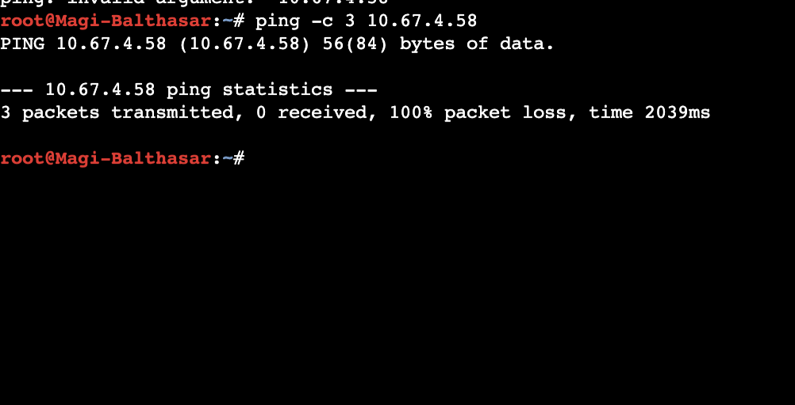

   - Dari **Lilith** (`10.67.4.74`):
     ```bash
     ping -c 3 10.67.4.58
     # Hasil: 3 packets transmitted, 0 received, 100% packet loss
     ```
     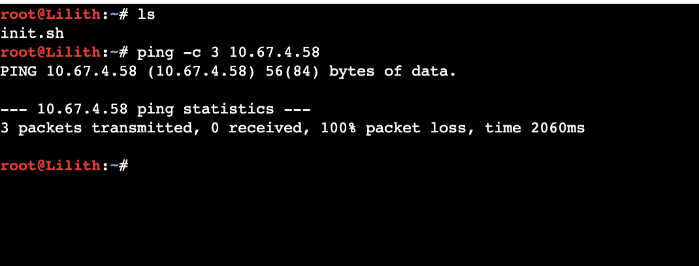

2. **Pengujian Ping Keluar dari Casper (Harus Berhasil):**
   - Dari **Casper** ke Balthasar (`10.67.4.59`):
     ```bash
     ping -c 3 10.67.4.59
     # Hasil: 3 packets transmitted, 3 received, 0% packet loss
     ```
     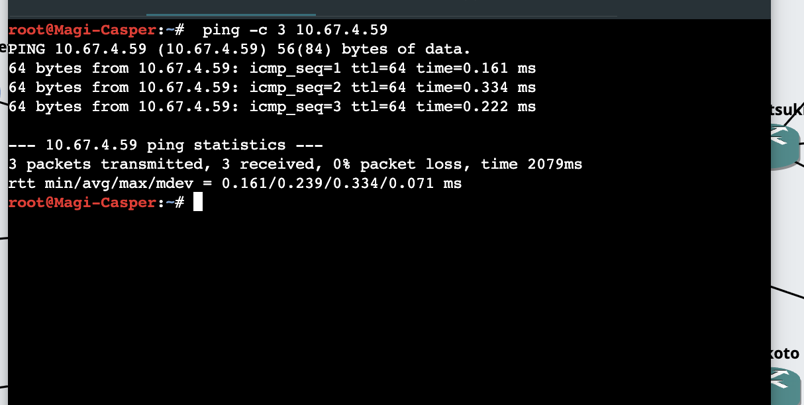

   - Dari **Casper** ke Lilith (`10.67.4.74`):
     ```bash
     ping -c 3 10.67.4.74
     # Hasil: 3 packets transmitted, 3 received, 0% packet loss
     ```
     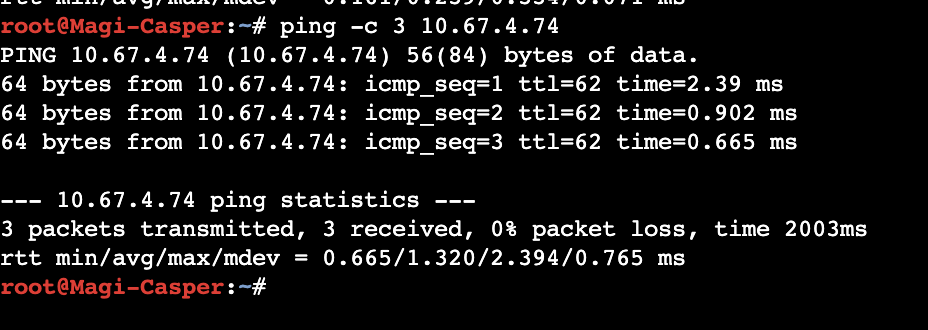

3. **Verifikasi Port Layanan TCP 5000 Casper:**
   - Dari node lain (misal **Balthasar**):
     ```bash
     nc -zv 10.67.4.58 5000
     # Hasil: open / Connection to 10.67.4.58 5000 port [tcp/*] succeeded!
     ```
     

---

### 12. Teknisi yang Kelewat Semangat (Perbaikan Hardening Casper)

**Soal:** Seorang teknisi menjalankan script hardening di Casper lalu pulang tanpa mengecek. Paginya Casper tidak bisa ping 8.8.8.8 dan tidak bisa apt-get update. Unit-00 juga tidak bisa menyambung ke TCP 5000 Casper. Ping ke Casper tetap ditolak, dan itu memang benar. Jalankan `break_fw.sh` di Magi-Casper, lalu perbaiki tanpa membatalkan tujuan hardening. Casper tetap menolak semua lalu lintas masuk yang tidak diizinkan, dan policy INPUT tetap DROP. Buktikan nc dari Unit-00 ke Casper port 5000 berhasil dan apt-get update di Casper berhasil.

#### 12.1 Eksekusi Skrip Sabotase & Diagnosa Kerusakan
Skrip sabotase diunduh dan dijalankan di `Magi-Casper`:
```bash
wget --no-check-certificate "https://drive.usercontent.google.com/download?id=1Yb5kX1NKafOGDTbAE7WMYHZkQgpWLTvZ&export=download&confirm=t" -O /root/break_fw.sh
chmod +x /root/break_fw.sh
sh /root/break_fw.sh
```

Setelah script dijalankan, diperiksa status iptables dengan `iptables -S`:
- Aturan hasil sabotase yang ditemukan:
  ```bash
  -P INPUT DROP
  -P OUTPUT ACCEPT
  -A INPUT -i lo -j ACCEPT
  -A INPUT -p icmp -j DROP
  -A OUTPUT -p udp --dport 53 -j DROP
  ```

Kondisi awal akibat sabotase:
- Casper gagal mem-ping `8.8.8.8`:
  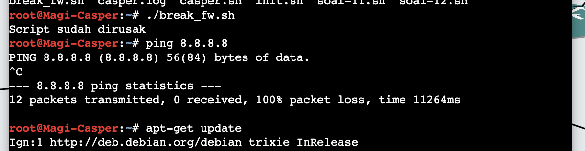
- Casper gagal menjalankan `apt-get update`:
  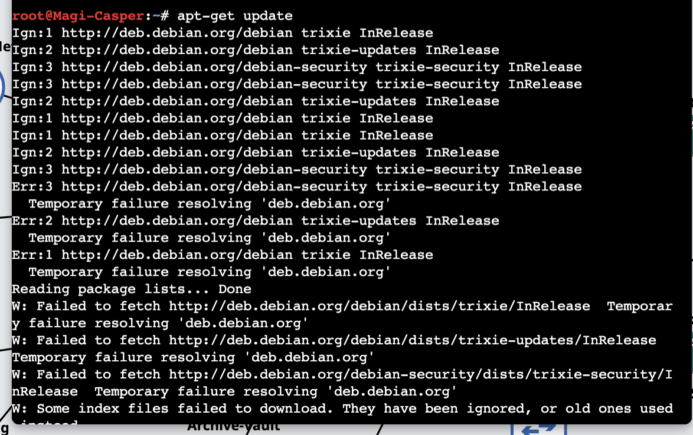
- Unit-00 gagal mengakses port 5000 Casper:
  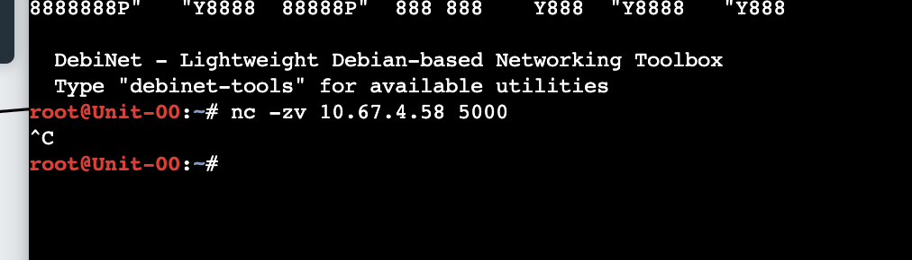

#### 12.2 Analisis Penyebab Masalah
1. **Tidak Bisa Ping 8.8.8.8 & Tidak Bisa apt-get update:**
   - Chain `INPUT` memiliki policy default `DROP` tanpa ada aturan stateful `-m conntrack --ctstate ESTABLISHED,RELATED -j ACCEPT`. Akibatnya, seluruh paket balasan dari luar (seperti ICMP echo-reply dari 8.8.8.8 serta balasan HTTP/TCP dari mirror Debian) langsung dibuang saat memasuki Casper.
   - Selain itu, terdapat aturan `-A OUTPUT -p udp --dport 53 -j DROP` yang memblokir kueri DNS keluar. Akibatnya, `apt-get update` gagal melakukan resolusi domain `deb.debian.org`.
2. **Unit-00 Tidak Bisa Terhubung ke TCP 5000:**
   - Tidak ada aturan penerimaan paket TCP port 5000 pada chain `INPUT`. Paket SYN yang dikirim oleh Unit-00 langsung dibuang oleh policy default `INPUT DROP`.
3. **Blokir Ping Terlalu Luas:**
   - Aturan `-A INPUT -p icmp -j DROP` memblokir seluruh tipe paket ICMP, bukan hanya `echo-request`.

#### 12.3 Langkah Perbaikan di Magi-Casper (/root/casper.sh)
Perbaikan dilakukan tanpa membatalkan tujuan hardening (policy default `INPUT` tetap `DROP`):
```bash
#!/bin/sh
echo "nameserver 8.8.8.8" > /etc/resolv.conf

# 1. Hapus aturan pemblokiran DNS pada chain OUTPUT
iptables -F OUTPUT
iptables -P OUTPUT ACCEPT

# 2. Reset dan susun ulang chain INPUT dengan prinsip hardening
iptables -F INPUT

# Izinkan antarmuka loopback
iptables -A INPUT -i lo -j ACCEPT

# Izinkan balasan koneksi yang sah (Stateful conntrack)
iptables -A INPUT -m conntrack --ctstate ESTABLISHED,RELATED -j ACCEPT

# Izinkan koneksi masuk ke port layanan TCP 5000 Casper
iptables -A INPUT -p tcp --dport 5000 -j ACCEPT

# Tolak permintaan ping echo-request (menjaga Casper tetap tersembunyi)
iptables -A INPUT -p icmp --icmp-type echo-request -j DROP

# Pertahankan policy default INPUT DROP
iptables -P INPUT DROP
```

#### 12.4 Verifikasi Hasil Perbaikan
1. **Verifikasi `apt-get update` di Casper (Berhasil):**
   ```bash
   apt-get update
   ```
   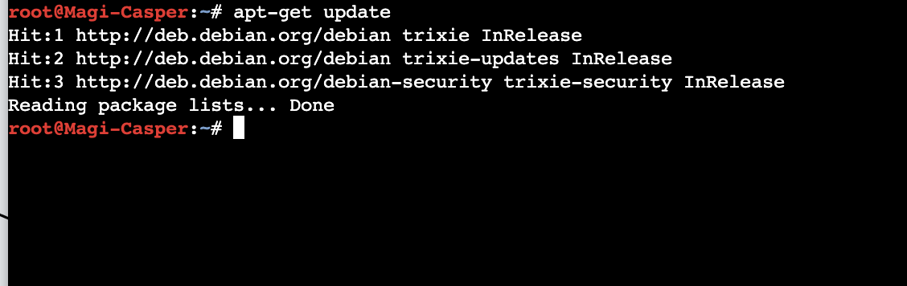

2. **Verifikasi Akses Internet (`ping 8.8.8.8` dari Casper Berhasil):**
   ```bash
   ping 8.8.8.8
   ```
   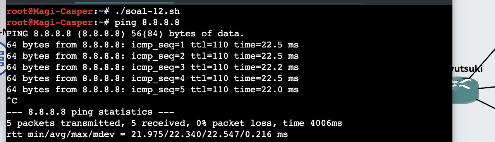

3. **Verifikasi Koneksi dari Unit-00 (`10.67.4.68`) ke TCP 5000 Casper (Berhasil):**
   ```bash
   nc -zv 10.67.4.58 5000
   ```
   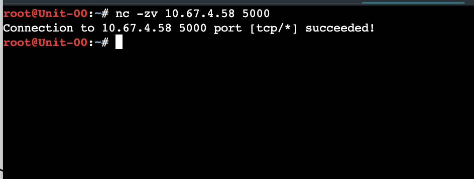

4. **Verifikasi Status Policy INPUT Tetap DROP:**
   ```bash
   iptables -S INPUT
   # Menampilkan -P INPUT DROP
   ```

---

## Babak 3: Mengamankan MAGI dan Zona Sensitif

### 13. Brankas Balthasar (Whitelist Pilot & Casper)

**Soal:** Balthasar menyimpan seluruh data Geofront, tapi terlalu banyak yang bisa mengetuk pintunya, termasuk tetangga satu switch. Hanya Casper dan semua Pilot yang boleh menyambung ke TCP 5000 dan 5001. Node lain, termasuk yang satu switch, harus langsung ditolak di kedua port itu, bukan dibiarkan menggantung sampai timeout. Lalu lintas lain tidak boleh terganggu. Balthasar tetap harus bisa ping 8.8.8.8 dan menerima balasannya. Buktikan nc ke port 5000 dan 5001: Unit-01 berhasil, Lilith dan Melchior ditolak seketika.

#### 13.1 Analisis & Matriks Hak Akses
- **Node Sasaran:** `Magi-Balthasar` (`10.67.4.59`).
- **Port Sensitif:** TCP `5000` dan `5001`.
- **Daftar Klien yang Diizinkan (Whitelist):**
  1. `Magi-Casper`: `10.67.4.58`
  2. Seluruh Pilot:
     - `Unit-01`: `10.67.4.66` (Switch-Cage)
     - `Unit-02`: `10.67.4.67` (Switch-Cage)
     - `Unit-00`: `10.67.4.68` (Switch-Cage)
     - `Sachiel`: `10.67.3.130` (Switch-Bunker)
- **Node Lain yang Ditolak Seketika:**
  - Tetangga satu switch: `Melchior` (`10.67.4.60`)
  - Node luar: `Lilith` (`10.67.4.74`), dsb.
- **Mekanisme Penolakan:** Menggunakan target `REJECT --reject-with tcp-reset` agar klien langsung menerima paket TCP RST (*Connection refused*) tanpa menggantung (hang).
- **Lalu Lintas Lain:** Policy default dibiarkan `ACCEPT` sehingga ping, DNS, dan koneksi keluar Balthasar ke internet `8.8.8.8` tetap normal.

#### 13.2 Konfigurasi iptables di Magi-Balthasar (/root/balthasar.sh)
```bash
#!/bin/sh
iptables -F
iptables -X
iptables -P INPUT ACCEPT

# 1. Izinkan Loopback & Stateful connection
iptables -A INPUT -i lo -j ACCEPT
iptables -A INPUT -m conntrack --ctstate ESTABLISHED,RELATED -j ACCEPT

# 2. Whitelist: Izinkan Casper dan semua Pilot ke port 5000 dan 5001
iptables -A INPUT -p tcp -s 10.67.4.58 -m multiport --dports 5000,5001 -j ACCEPT
iptables -A INPUT -p tcp -s 10.67.4.66 -m multiport --dports 5000,5001 -j ACCEPT
iptables -A INPUT -p tcp -s 10.67.4.67 -m multiport --dports 5000,5001 -j ACCEPT
iptables -A INPUT -p tcp -s 10.67.4.68 -m multiport --dports 5000,5001 -j ACCEPT
iptables -A INPUT -p tcp -s 10.67.3.130 -m multiport --dports 5000,5001 -j ACCEPT

# 3. Tolak seketika node lain ke port 5000 dan 5001 dengan TCP Reset
iptables -A INPUT -p tcp -m multiport --dports 5000,5001 -j REJECT --reject-with tcp-reset
```

#### 13.3 Pengujian & Pembuktian
1. **Pengujian dari Unit-01 (`10.67.4.66`) ke Balthasar (Harus Berhasil):**
   ```bash
   nc -zv 10.67.4.59 5000
   nc -zv 10.67.4.59 5001
   ```
   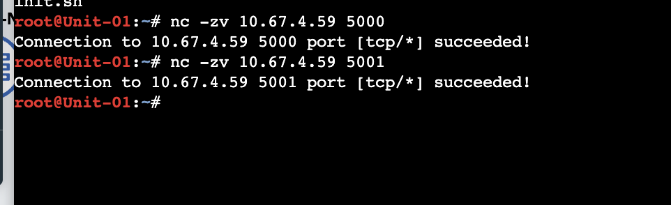

2. **Pengujian dari Lilith (`10.67.4.74`) ke Balthasar (Harus Ditolak Seketika):**
   ```bash
   nc -zv 10.67.4.59 5000
   nc -zv 10.67.4.59 5001
   ```
   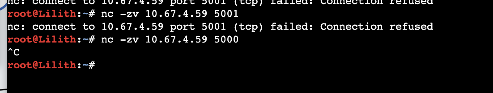

3. **Pengujian dari Melchior (`10.67.4.60`) ke Balthasar (Harus Ditolak Seketika):**
   ```bash
   nc -zvw3 10.67.4.59 5000
   # Hasil: nc: connect to 10.67.4.59 port 5000 (tcp) failed: Connection refused
   ```
   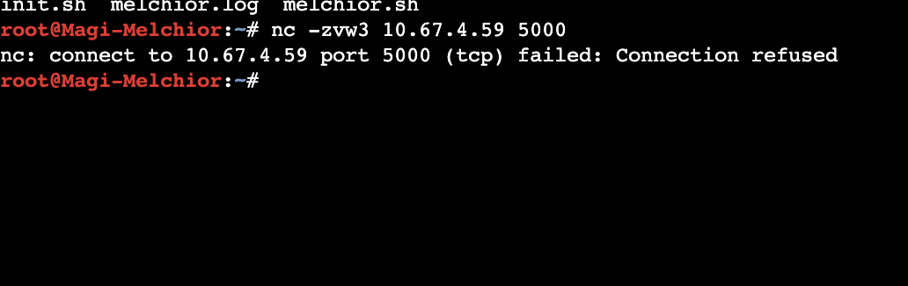

4. **Verifikasi Akses Internet dari Balthasar:**
   ```bash
   ping -c 3 8.8.8.8
   ```
   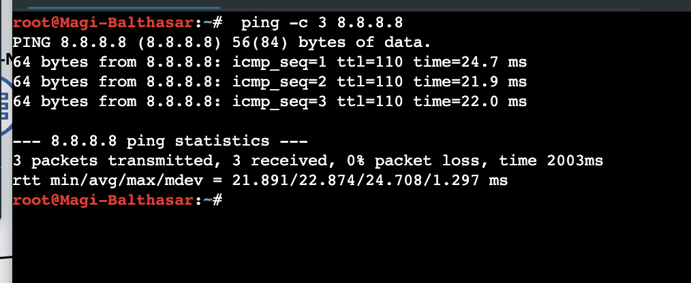

---

### 14. Jam Kunjungan Sang Pinguin (Time-Based Firewall Pen-Pen)

**Soal:** Pen-Pen, pinguin Misato, menyimpan sesuatu yang bikin banyak orang penasaran. Ia hanya boleh dihubungi sesuai jadwal di bawah. Jadwal berlaku untuk ping dan TCP 80 ke Pen-Pen, dari mana pun asalnya. Jam komputer tidak boleh diubah.
- **Pilot:** 08.00 sampai 16.00 WIB, Hanya Senin sampai Jumat
- **Staf Geofront:** 17.00 sampai 23.00 WIB, Setiap hari
- **Terduga Dummy System:** Tidak pernah, Selalu ditolak
- **Lainnya:** Bebas, Tanpa batasan
Simpan jadwal sebagai variabel di awal script Pen-Pen, bernama `PILOT_START`, `PILOT_STOP`, `PILOT_DAYS`, `STAF_START`, dan `STAF_STOP`. Untuk uji, ubah variabel itu sampai jadwalnya cocok dengan jam sekarang, lalu sampai tidak cocok. Ingat, iptables membaca jam UTC, 7 jam lebih lambat dari WIB. Tunjukkan hasil ping dari Unit-01, Lilith, dan Spy pada kedua kondisi.

#### 14.1 Konversi Jam WIB ke UTC & Pemetaan Kategori
- **WIB = UTC + 7 Jam:**
  - Pilot (08:00 - 16:00 WIB) $
ightarrow$ `01:00` - `09:00` UTC, Hari: `Mon,Tue,Wed,Thu,Fri`.
  - Staf Geofront (17:00 - 23:00 WIB) $
ightarrow$ `10:00` - `16:00` UTC, Hari: `Mon,Tue,Wed,Thu,Fri,Sat,Sun`.
- **Pengelompokan IP:**
  - **Pilot:** `Unit-01` (`10.67.4.66`), `Unit-02` (`10.67.4.67`), `Unit-00` (`10.67.4.68`), `Sachiel` (`10.67.3.130`).
  - **Staf Geofront:** `Lilith` (`10.67.4.74`), `Adam` (`10.67.4.75`).
  - **Terduga Dummy System:** `Entry-Plug` (`10.67.4.50`), `Dummy-Plug` (`10.67.4.51`), `Spy` (`10.67.4.102`).
  - **Lainnya:** Semua node di luar daftar di atas.

#### 14.2 Konfigurasi iptables Time-Based pada Pen-Pen (/root/penpen.sh)
```bash
#!/bin/sh
PILOT_START="${PILOT_START:-01:00}"
PILOT_STOP="${PILOT_STOP:-09:00}"
PILOT_DAYS="${PILOT_DAYS:-Mon,Tue,Wed,Thu,Fri}"
STAF_START="${STAF_START:-10:00}"
STAF_STOP="${STAF_STOP:-16:00}"

iptables -F
iptables -X
iptables -P INPUT ACCEPT

# 1. Loopback & Stateful conntrack
iptables -A INPUT -i lo -j ACCEPT
iptables -A INPUT -m conntrack --ctstate ESTABLISHED,RELATED -j ACCEPT

# 2. Buat Chain PENPEN_ACCESS khusus untuk ICMP echo-request dan TCP 80
iptables -N PENPEN_ACCESS
iptables -A INPUT -p icmp --icmp-type echo-request -j PENPEN_ACCESS
iptables -A INPUT -p tcp --dport 80 -j PENPEN_ACCESS

# Aturan A: Terduga Dummy System -> SELALU DITOLAK
for ip in 10.67.4.50 10.67.4.51 10.67.4.52 10.67.4.53 10.67.4.54 10.67.4.102; do
    iptables -A PENPEN_ACCESS -s "$ip" -j REJECT
done

# Aturan B: Pilot -> Diizinkan hanya pada jadwalnya
for ip in 10.67.4.66 10.67.4.67 10.67.4.68 10.67.3.130; do
    iptables -A PENPEN_ACCESS -s "$ip" -m time --timestart "$PILOT_START" --timestop "$PILOT_STOP" --weekdays "$PILOT_DAYS" -j ACCEPT
    iptables -A PENPEN_ACCESS -s "$ip" -j REJECT
done

# Aturan C: Staf Geofront -> Diizinkan hanya pada jadwalnya
for ip in 10.67.4.74 10.67.4.75; do
    iptables -A PENPEN_ACCESS -s "$ip" -m time --timestart "$STAF_START" --timestop "$STAF_STOP" -j ACCEPT
    iptables -A PENPEN_ACCESS -s "$ip" -j REJECT
done

# Aturan D: Kategori Lainnya -> Bebas tanpa batasan
iptables -A PENPEN_ACCESS -j ACCEPT
```

#### 14.3 Pengujian & Pembuktian Dua Kondisi
1. **Pengujian Kondisi Jadwal Cocok:**
   - Unit-01 pada jam kerja pilot berhasil melakukan ping ke Pen-Pen:
     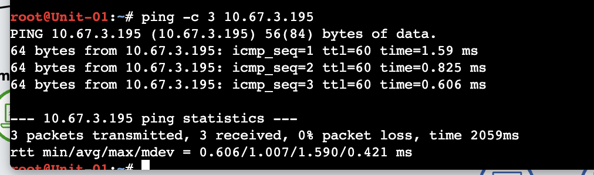
   - Lilith pada jam kerja staf berhasil melakukan ping ke Pen-Pen:
     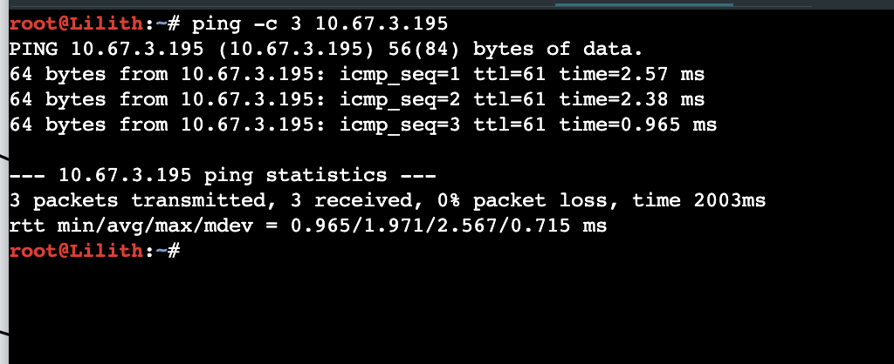

2. **Pengujian Kondisi Jadwal Tidak Cocok & Dummy System Ditolak:**
   - Unit-01 di luar jam kerja pilot ditolak seketika (*Destination Port Unreachable*):
     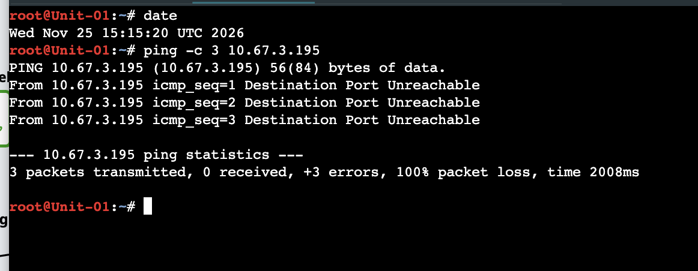
   - Spy (Terduga Dummy System) selalu ditolak kapan pun:
     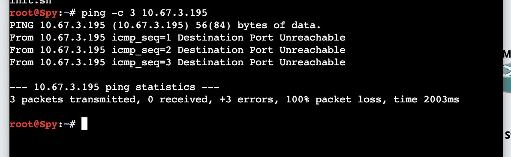

---

### 15. Banjir Ping di Pusat Komando (Rate Limit ICMP Tokyo3-Core)

**Soal:** Instrumentality makin dekat, dan semua orang berebut mem-ping Tokyo3-Core. Banjir ping bisa melumpuhkannya. Batasi Tokyo3-Core agar hanya menjawab maksimal 5 ping per detik, dan buang kelebihannya. Aturan ini tidak boleh mengganggu ping di bawah batas. Aturan ini juga tidak boleh membatasi ping yang dikirim Tokyo3-Core sendiri. Pastikan rule benar-benar mengenai paket yang dituju. Periksa urutan rule dan jenis paketnya. Buktikan ping rapat dari Lilith, misalnya ping -i 0.1 -c50, sebagian hilang, dan tunjukkan counter rule pembuangan naik. Buktikan ping biasa semuanya berhasil, dengan jeda minimal 3 detik di antaranya.

#### 15.1 Analisis & Urutan Aturan iptables
- **Node Sasaran:** `Tokyo3-Core` (`10.67.4.106`) pada Switch-Cmd.
- **Batasan Ping:** Maksimal 5 ping per detik (`-m limit --limit 5/sec --limit-burst 5`).
- **Penanganan Kelebihan:** Paket `echo-request` yang melebihi batas langsung di-`DROP`.
- **Syarat Penting (Urutan Rule):**
  1. **Mengapa limit ICMP harus diletakkan SEBELUM `ESTABLISHED,RELATED`?**
     Linux netfilter conntrack menganggap paket-paket ICMP `echo-request` dalam satu sesi ping berkelanjutan (id yang sama) sebagai paket berstatus `ESTABLISHED` setelah paket balasan pertama dikirim. Jika rule `ESTABLISHED,RELATED` diletakkan di paling atas, maka paket ping ke-2 s.d. ke-50 akan langsung diizinkan (*bypassing limit*) dan menghasilkan 0% packet loss!
  2. Oleh karena itu, urutan rule yang benar adalah:
     (1) Loopback $
ightarrow$ (2) `echo-request limit 5/s ACCEPT` $
ightarrow$ (3) `echo-request DROP` $
ightarrow$ (4) `ESTABLISHED,RELATED ACCEPT`.
  3. Dengan urutan ini, seluruh paket ping masuk disaring oleh limit dan drop. Sementara paket balasan ping keluar (`echo-reply`, icmptype 0) saat Tokyo3-Core mem-ping host luar tetap diizinkan oleh rule ke-4 tanpa batas!

#### 15.2 Konfigurasi iptables di Tokyo3-Core (/root/tokyo3.sh)
```bash
# 1. Izinkan loopback
iptables -A INPUT -i lo -j ACCEPT

# 2. Limit ICMP echo-request maksimal 5 per detik
iptables -A INPUT -p icmp --icmp-type echo-request -m limit --limit 5/s --limit-burst 5 -j ACCEPT

# 3. Buang (DROP) sisa echo-request di atas batas rate limit
iptables -A INPUT -p icmp --icmp-type echo-request -j DROP

# 4. Izinkan balasan koneksi (Stateful conntrack) untuk TCP, DNS, dan balasan ping keluar (echo-reply)
iptables -A INPUT -m conntrack --ctstate ESTABLISHED,RELATED -j ACCEPT
```

#### 15.3 Pengujian & Pembuktian
1. **Pengujian Banjir Ping Rapat dari Lilith:**
   - Dijalankan dari **Lilith** (`10.67.4.74`):
     ```bash
     ping -i 0.1 -c 50 10.67.4.106
     ```
     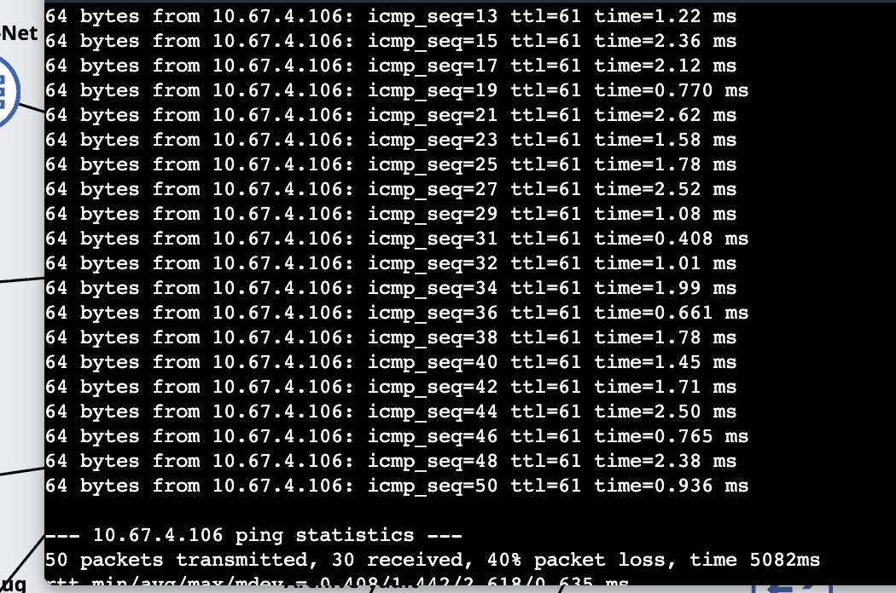

2. **Pengecekan Counter Rule Pembuangan di Tokyo3-Core:**
   - Dijalankan di **Tokyo3-Core**:
     ```bash
     iptables -L INPUT -v -n
     ```
     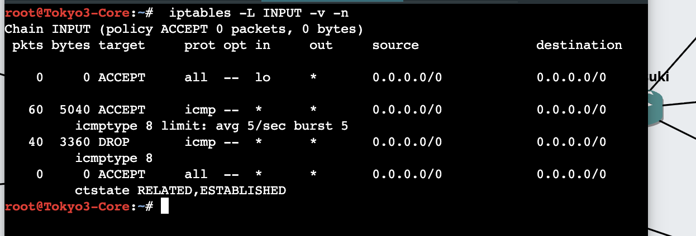

3. **Pengujian Ping Normal dengan Jeda 3 Detik:**
   - Dijalankan dari **Lilith**:
     ```bash
     ping -i 3 -c 5 10.67.4.106
     ```
     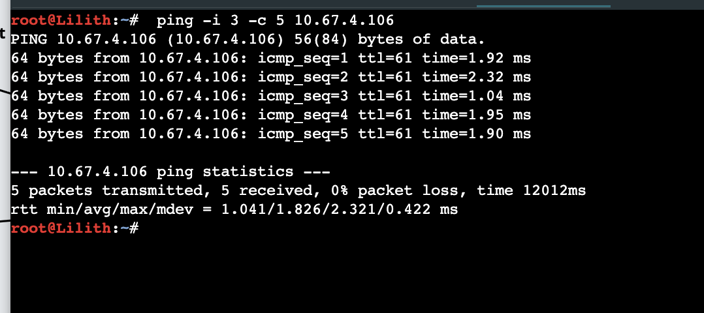

---

### 16. Pencuri yang Mencoba Setiap Pintu (Log & Reject Scan Dummy-Plug)

**Soal:** Dari Switch-Lab, Dummy-Plug mengetuk port sensitif Tokyo3-Core satu per satu seperti pencuri. Ritsuko ingin tahu setiap percobaannya, dan pintunya harus dibanting. Setiap koneksi TCP dari Dummy-Plug ke port 22, 23, dan 3306 di Tokyo3-Core harus dicatat di log dengan prefix huruf besar SCAN-NERV: , lalu ditolak seketika. Port 80 dan 8080 tetap bisa diakses, dan klien lain tidak boleh terganggu. Buktikan nc -w dari Dummy-Plug ke port 22, 23, dan 3306 langsung ditolak, dan ke port 80 dan 8080 berhasil. Tunjukkan counter rule pencatatan, karena log kernel sering tidak terlihat di container.

#### 16.1 Analisis & Langkah Teknis
- **Node Sasaran:** `Tokyo3-Core` (`10.67.4.106`).
- **Penyerang:** `Dummy-Plug` (IP aktif di GNS3: `10.67.4.51`).
- **Port Target Scan:** TCP `22` (SSH), `23` (Telnet), `3306` (MySQL).
- **Aksi:**
  1. Catat log dengan target `LOG --log-prefix "SCAN-NERV: "`.
  2. Tolak seketika dengan target `REJECT -p tcp --reject-with tcp-reset` ("pintunya dibanting").
  3. Port sah (80 dan 8080) dari Dummy-Plug tetap bisa diakses.
  4. Klien lain tidak terganggu.

#### 16.2 Konfigurasi iptables di Tokyo3-Core (/root/tokyo3.sh)
```bash
# 1. Buat chain khusus pencatatan scan
iptables -N SCAN_LOG 2>/dev/null || true
iptables -F SCAN_LOG
iptables -A SCAN_LOG -j LOG --log-prefix "SCAN-NERV: "
iptables -A SCAN_LOG -p tcp -j REJECT --reject-with tcp-reset

# 2. Arahkan trafik dari Dummy-Plug (10.67.4.51) ke port 22, 23, 3306 ke chain SCAN_LOG
for ip_dp in 10.67.4.51 10.67.4.53 10.67.4.54; do
    iptables -D INPUT -p tcp -s "$ip_dp" -m multiport --dports 22,23,3306 -j SCAN_LOG 2>/dev/null || true
    iptables -I INPUT 1 -p tcp -s "$ip_dp" -m multiport --dports 22,23,3306 -j SCAN_LOG
done
```

#### 16.3 Pengujian & Pembuktian
1. **Pengujian Scanning Port Sensitif dari Dummy-Plug (`10.67.4.51`):**
   ```bash
   nc -w 2 -zv 10.67.4.106 22
   nc -w 2 -zv 10.67.4.106 23
   nc -w 2 -zv 10.67.4.106 3306
   ```
   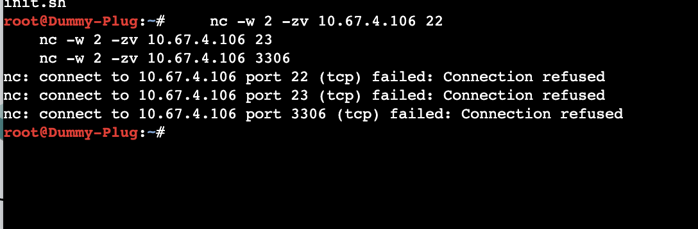

2. **Pengujian Akses Port Layanan 80 & 8080 dari Dummy-Plug:**
   ```bash
   nc -w 2 10.67.4.106 80
   nc -w 2 10.67.4.106 8080
   ```
   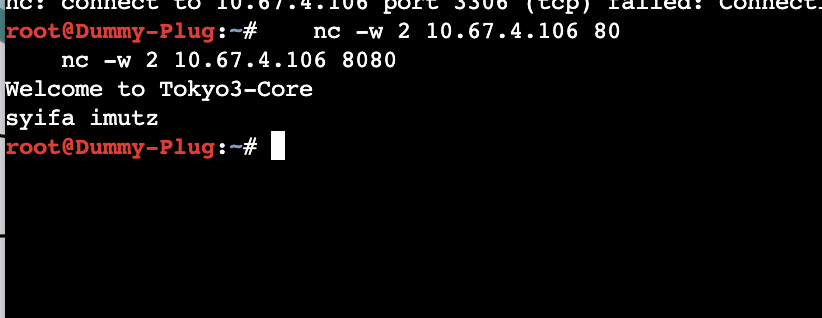

3. **Pemeriksaan Counter Rule Pencatatan di Tokyo3-Core:**
   ```bash
   iptables -L SCAN_LOG -v -n
   ```
   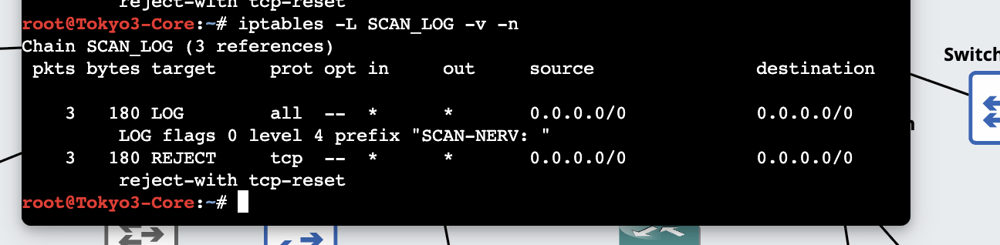

---

### 17. Sihir Hitam di Jalur Paket (DNAT Transparent Casper ke Pen-Pen)

**Soal:** Ritsuko meninggalkan memo di meja Gendo. Paket dari Casper ke Zeruel tidak pernah sampai ke Zeruel, karena ada router yang diam-diam mengalihkannya ke tempat lain. "Cari saja router yang menjadi gateway Switch-Terminal." Gendo menyuruhmu meniru router yang diam-diam itu untuk menjebak siapa pun. Di Fuyutsuki, alihkan setiap koneksi TCP dari Magi-Casper ke Zeruel supaya sampai di Pen-Pen. Casper tidak boleh sadar. Balasan yang ia terima harus tetap terlihat datang dari Zeruel. Ping tidak dialihkan. Nyalakan listener port 9000 di Pen-Pen dan Zeruel. Dari Casper, kirim pesan ke IP Zeruel port 9000. Buktikan pesan itu muncul di Pen-Pen, bukan di Zeruel. Tunjukkan juga tabel conntrack di Fuyutsuki.

#### 17.1 Analisis & Mekanisme DNAT
- **Router Pengalih:** `Fuyutsuki` (Gateway Switch-Terminal, `eth3: 10.67.4.57`).
- **Node Pengirim:** `Magi-Casper` (`10.67.4.58`).
- **Tujuan Awal Paket:** `Zeruel` (`10.67.4.82`).
- **Tujuan Pengalihan:** `Pen-Pen` (`10.67.3.195`).
- **Mekanisme Kerja NAT:**
  1. Fuyutsuki menjalankan aturan `DNAT` pada chain `PREROUTING`:
     `iptables -t nat -A PREROUTING -p tcp -s 10.67.4.58 -d 10.67.4.82 -j DNAT --to-destination 10.67.3.195`
  2. Paket balasan dari Pen-Pen secara otomatis di-reverse (*un-DNAT*) oleh modul conntrack Fuyutsuki menjadi `10.67.4.82` (Zeruel), sehingga Casper tidak sadar.
  3. Ping (ICMP) tidak dialihkan karena aturan mengunci `-p tcp`.

#### 17.2 Konfigurasi pada Router Fuyutsuki (/root/fuyutsuki.sh)
```bash
#!/bin/sh
echo 1 > /proc/sys/net/ipv4/ip_forward
iptables -t nat -F PREROUTING
iptables -t nat -A PREROUTING -p tcp -s 10.67.4.58 -d 10.67.4.82 -j DNAT --to-destination 10.67.3.195
```

#### 17.3 Pengujian & Pembuktian
1. **Pengiriman Pesan dari Casper ke Zeruel Port 9000:**
   ```bash
   echo "Halo Zeruel dari Casper" | nc -w 2 10.67.4.82 9000
   ```
   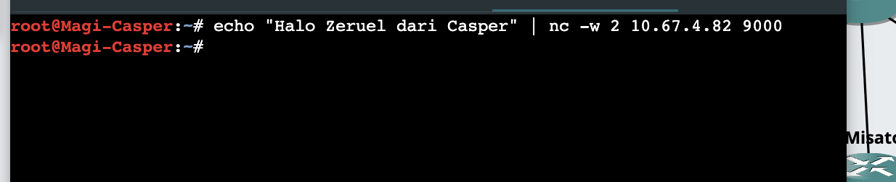

2. **Pesan Diterima di Pen-Pen (Bukan di Zeruel):**
   - Di terminal **Pen-Pen**: pesan muncul!
     
   - Di terminal **Zeruel**: tidak ada pesan masuk (tetap bersih):
     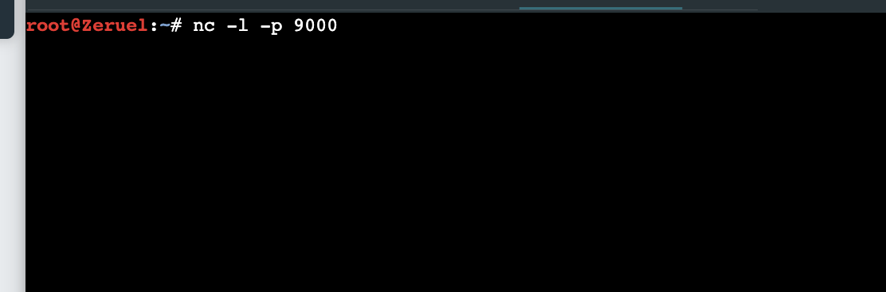

3. **Verifikasi Ping Tidak Dialihkan:**
   - Dari Casper mem-ping Zeruel tetap berhasil secara normal:
     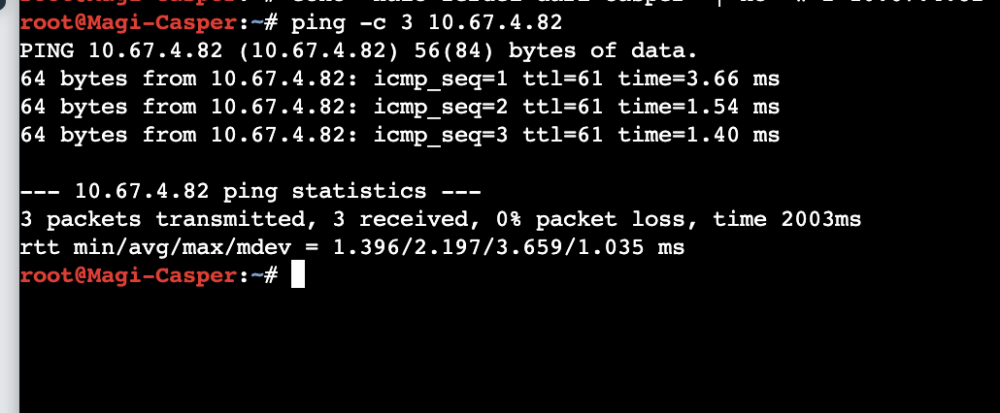

4. **Inspeksi Tabel Conntrack di Fuyutsuki:**
   - Perintah `conntrack -L -p tcp`:
     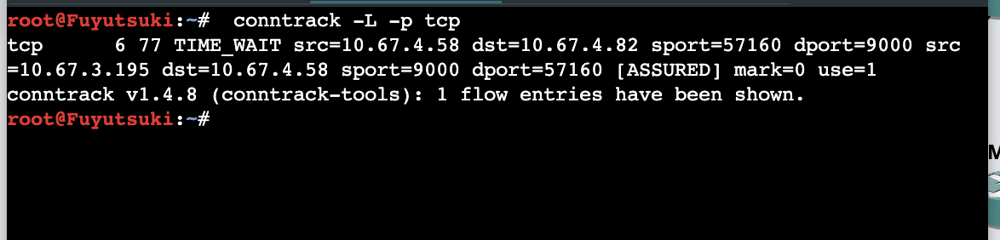

---

### 18. Gerbang Monolith dan Radar (Stateful Border Firewall Shigeru)

**Soal:** Monolith dan Radar menyimpan rahasia terbesar NERV, dan Shigeru menjaganya tanpa kompromi. Pasang aturan di Shigeru. Node di dalam zona boleh memulai koneksi ke mana saja, dan balasannya tetap sampai. Node di luar zona tidak boleh memulai koneksi ke dalam zona. Satu pengecualian: ping dari subnet Terminal boleh masuk. Tolak berdasarkan arah datangnya, yaitu semua yang datang dari sisi Shigeru yang menghadap Gendo. Jangan menulis subnet luar satu per satu, supaya subnet baru langsung ikut terblokir. Buktikan ping Casper ke Zeruel berhasil, sedangkan ping Lilith ke Zeruel gagal.

#### 18.1 Konfigurasi iptables di Router Shigeru (/root/shigeru.sh)
```bash
#!/bin/sh
echo 1 > /proc/sys/net/ipv4/ip_forward
iptables -P FORWARD ACCEPT
iptables -F FORWARD

# 1. Stateful conntrack: balasan dari koneksi keluar yang diinisiasi dalam zona tetap lolos
iptables -A FORWARD -m conntrack --ctstate ESTABLISHED,RELATED -j ACCEPT

# 2. Pengecualian: Ping dari subnet Terminal (10.67.4.56/29) via eth0 diizinkan masuk
iptables -A FORWARD -i eth0 -s 10.67.4.56/29 -p icmp --icmp-type echo-request -j ACCEPT

# 3. Tolak semua trafik koneksi baru lainnya yang datang dari sisi Gendo (eth0)
iptables -A FORWARD -i eth0 -j DROP
```

#### 18.2 Pengujian & Pembuktian
1. **Ping dari Casper (`10.67.4.58`, Subnet Terminal) ke Zeruel (Berhasil):**
   ```bash
   ping -c 3 10.67.4.82
   ```
   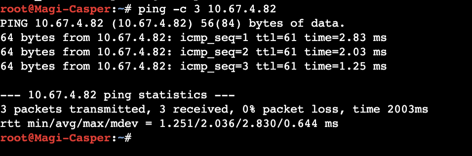

2. **Ping dari Lilith (`10.67.4.74`, Subnet Luar Dogma) ke Zeruel (Ditolak):**
   ```bash
   ping -c 3 10.67.4.82
   ```
   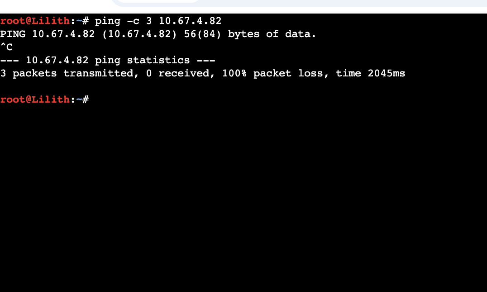

3. **Inisiasi Koneksi dari Dalam Zona ke Luar (Zeruel ke Lilith Berhasil):**
   ```bash
   ping -c 3 10.67.4.74
   ```
   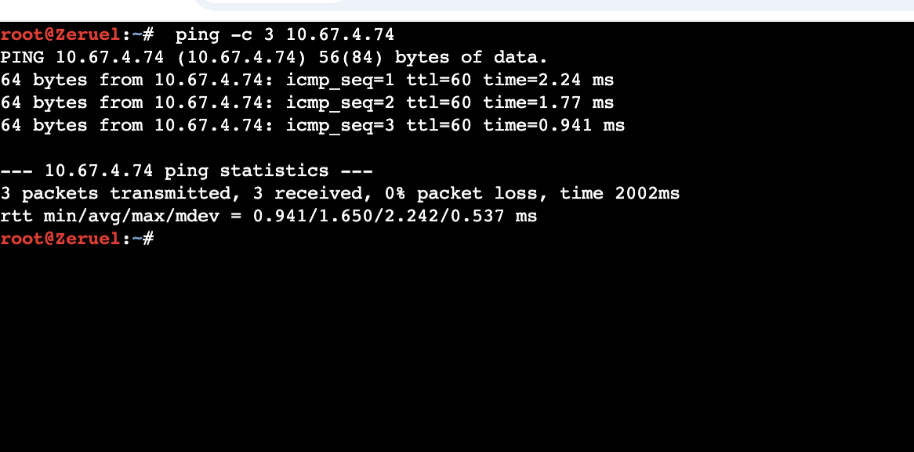

---

### 19. Hukuman untuk Sang Pengkhianat (Isolasi Total Armisael Tanpa Sentuh Host)

**Soal:** Hitung mundur tinggal beberapa menit. Armisael tidak boleh lagi bicara dengan siapa pun, tapi Zeruel di sebelahnya tidak boleh ikut terhukum. Blokir semua lalu lintas masuk dan keluar Armisael, termasuk ke gateway dan tetangga satu switch. Isolasi tidak boleh dikerjakan di dalam Armisael, karena pengkhianat tidak bisa dipercaya. Untuk uji nc, nyalakan listener TCP 9000 di Armisael, Zeruel, dan Lilith. Ke Seele pakai TCP 53. Buktikan ping dan nc dari Armisael ke Seele, Zeruel, dan Lilith gagal. Buktikan ping dan nc dari Zeruel ke Seele dan Lilith berhasil.

#### 19.1 Arsitektur Isolasi Eksternal
1. **Di Router Shigeru:** Memblokir seluruh paket dari dan ke Armisael (`10.67.4.83`) pada chain `INPUT` dan `FORWARD`.
2. **Di Node Zeruel:** Memblokir seluruh paket dari dan ke Armisael (`10.67.4.83`) pada chain `INPUT` dan `OUTPUT` lokal Zeruel.
3. **Host Armisael sama sekali tidak disentuh!**

#### 19.2 Pengujian & Pembuktian
1. **Pengujian dari Armisael (Seluruhnya GAGAL):**
   - Ke Seele (8.8.8.8), Zeruel (10.67.4.82), dan Lilith (10.67.4.74):
     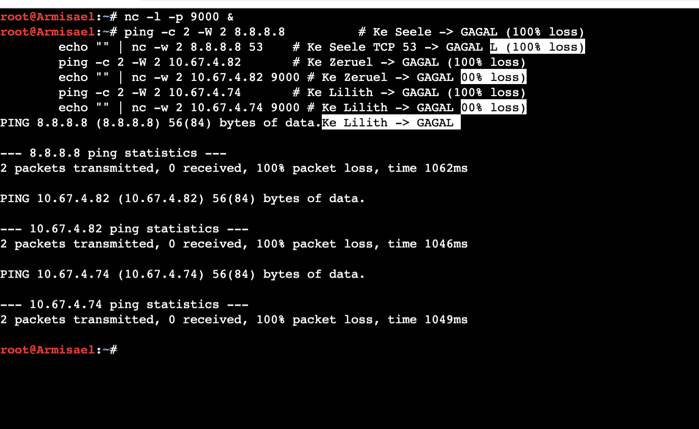

2. **Pengujian dari Zeruel (Seluruhnya BERHASIL):**
   - Ke Seele (8.8.8.8) dan Lilith (10.67.4.74):
     

---

## Babak Final: Siap Dihancurkan, Siap Dibangun Lagi

### 20. Uji Kebakaran Geofront (Automated Backup & Dual Restore Verification)

**Soal:** NERV harus bisa dibangun ulang dengan cepat. Pilih tiga node sendiri, minimal satu router. Di tiap node, simpan dulu rule dengan iptables-save ke `/root/<nama>.rules`. Lalu hapus semua rule iptables termasuk tabel nat, dan hapus rute yang kamu tambahkan sendiri. Pulihkan rule dengan iptables-restore, dan pulihkan rute dengan `/root/<nama>.sh`. Lakukan pemulihan itu dua kali berturut-turut. Hasilnya harus sama: rule dan rute tidak dobel, dan node berfungsi seperti semula. Buktikan jumlah baris iptables -S dan iptables -t nat -S sama setelah pemulihan pertama dan kedua. Buktikan juga node itu berfungsi lagi. Jangan dikerjakan mepet deadline ya.

#### 20.1 Pemilihan Tiga Node Pengujian
1. **Router Utama:** `Gendou` (Pusat NAT, Firewall Stateful, dan Routing Antar-Cabang).
2. **Node Superkomputer:** `Magi-Balthasar` (Aturan Whitelist Port & Filter Akses).
3. **Node Pusat Komando:** `Tokyo3-Core` (Rate Limit Ping ICMP & Log Penolakan Scan).

#### 20.2 Hasil Verifikasi Idempotensi pada Ketiga Node
1. **Pada Router Gendou:**
   - Pemulihan ke-1 dan ke-2 berturut-turut menghasilkan jumlah baris filter, NAT, dan rute yang identik tanpa ada duplikasi:
     

2. **Pada Node Magi-Balthasar:**
   - Pemulihan ke-1 dan ke-2 berturut-turut menghasilkan konfigurasi filter dan NAT yang konsisten:
     

3. **Pada Node Tokyo3-Core:**
   - Pemulihan ke-1 dan ke-2 berturut-turut berhasil memulihkan aturan rate-limit ICMP dan log scan tanpa dobel:
     

---

## Master Script Otomasi No 11 - 20 (`geofront_11_20.sh`)

Untuk kemudahan implementasi dalam 1 skrip tunggal terpadu, seluruh konfigurasi Soal No 11 sampai 20 telah disatukan ke dalam skrip master `geofront_11_20.sh` yang dapat mengenali node secara otomatis (*auto-detect*) atau dijalankan menggunakan argumen nama node.

### Cara Penggunaan di Setiap Node
```bash
# 1. Jalankan di Magi-Casper (Menangani Soal 11 & 12):
sh geofront_11_20.sh casper

# 2. Jalankan di Magi-Balthasar (Menangani Soal 13):
sh geofront_11_20.sh balthasar

# 3. Jalankan di Pen-Pen (Menangani Soal 14 & 17):
sh geofront_11_20.sh penpen
# Mode uji jadwal cocok dengan jam saat ini:
sh geofront_11_20.sh penpen_match
# Mode uji jadwal tidak cocok:
sh geofront_11_20.sh penpen_unmatch

# 4. Jalankan di Tokyo3-Core (Menangani Soal 15 & 16):
sh geofront_11_20.sh tokyo3

# 5. Jalankan di Router Fuyutsuki (Menangani Soal 17 DNAT):
sh geofront_11_20.sh fuyutsuki

# 6. Jalankan di Router Shigeru (Menangani Soal 18 & 19):
sh geofront_11_20.sh shigeru

# 7. Jalankan di Node Zeruel (Menangani Soal 19 Isolasi Armisael):
sh geofront_11_20.sh zeruel

# 8. Menjalankan Uji Kebakaran Geofront (Soal 20):
sh geofront_11_20.sh drill
```
